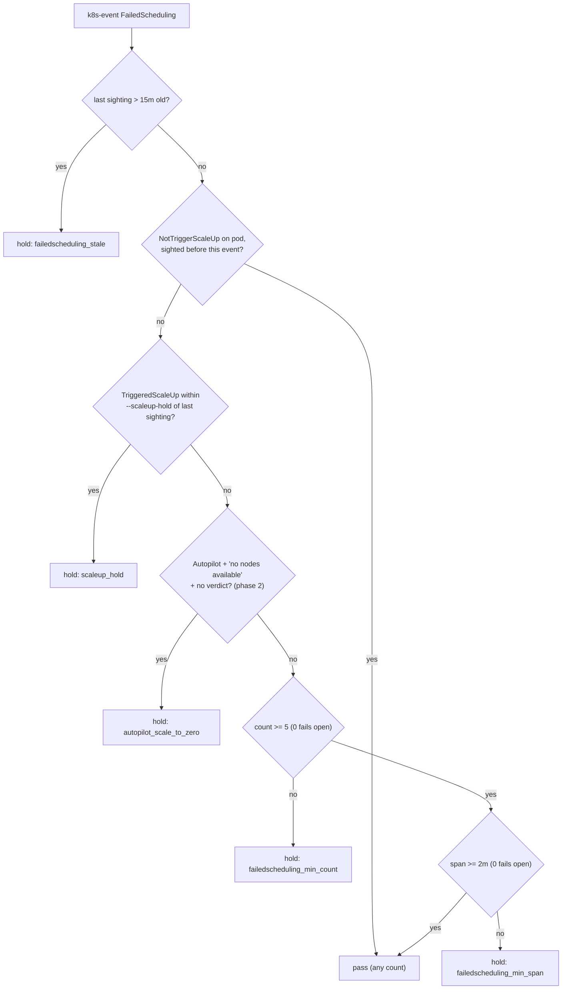

# `kube-agents` event-watcher noise controls — assessment and adoption plan

**Date:** 2026-11-18 · **Subjects:** `kube-agents` @ `ac3e39992` (2026-11-17) · `k8s-lookout` @ `d810e85` (`v0.43.2-9-gd810e85` / `v0.44.0-dev`)

**TL;DR:** Since the 2026-10-18 cross-assessment (`kube-agents/a2a/k8s-lookout-assessment.md`), `kube-agents`'s `k8s-event-watcher` landed ~10 PRs targeting false positives, duplicates, and chatter, backed by 30-day multi-cluster measurements. `lookout watch` already outperforms the watcher on post-open lifecycle (exponential repeat backoff, state-based recovery, 4-tier storm correlation, same-class owner folding, SQLite store), but has four real leading-edge gaps: no `events.k8s.io/v1` `Series` fallback (live on GKE Standard 1.37; reopens #218), ungated `FailedScheduling` during scale-ups, no duration-based settle gate for startup blips (#214's closing prescription), and no per-object alert-exclude rules that keep a cluster watched. Adopt K3 (`Series` + fail-open), K2 (settle gate on crash-loop + message-allowlisted `Failed` only), K1 (`FailedScheduling` verdict + count/span gate, phase 2 Autopilot scale-to-zero via `pkg/cloud.Provider`), and K4 (`--alert-excludes <file>` routing matches to `info`). Defer K5 cross-reason fold (conflicts with DESIGN §7.7); take no action on K5 fix-PR hold, K6 quiet follow-up, and K8; track K7 `Retry-After` as an unscheduled line in the umbrella issue.

Every `file:line` claim below was verified against `k8s-lookout @ d810e85` and `kube-agents @ ac3e39992` on 2026-11-18; grep commands are quoted where the answer is "nothing". Each section ends with an explicit **RECOMMENDATION** line.

**Contents**

1. [Context and method](#1-context-and-method)
2. [What lookout already has that the watcher does not](#2-what-lookout-already-has-that-the-watcher-does-not)
3. [Gate-by-gate matrix (K1–K8)](#3-gate-by-gate-matrix-k1k8)
4. [The adopted items, in lookout's shape](#4-the-adopted-items-in-lookouts-shape)
5. [Corrections to the 2026-10-18 assessment](#5-corrections-to-the-2026-10-18-assessment)
6. [Operator, agent, demo-scenario, and e2e impact](#6-operator-agent-demo-scenario-and-e2e-impact)
7. [Decisions table and consolidated action list](#7-decisions-table-and-consolidated-action-list)

---

## 1. Context and method

`kube-agents/k8s-operator/cmd/k8s-event-watcher` is the descendant of the watcher that seeded `lookout watch` ([`DESIGN.md` §7](../DESIGN.md#7-watch-path-lookout-watch-the-sentinel)). Both repositories shared the early count debounces (#197 crash-loop debounce, #213/#216 transient image-pull classifier), then diverged. `k8s-lookout` invested in leading-indicator sources, storm correlation, recovery tracking, repeat backoff (#599), and replay tombstones (#816); `kube-agents` invested in pre-forward noise gates on the `core/v1.Event` stream and daemon-side folding in `agents/platform/scripts/session_kv_server.py`.

### 1.1 What changed in `kube-agents` since 2026-10-18

Before 2026-10-18, `k8s-event-watcher` had already added the initial `FailedScheduling` autoscaler-verdict gate (#1789, 2026-10-02) and the Autopilot scale-to-zero hold (#2606, 2026-10-08). Between 2026-10-18 and `ac3e39992` (2026-11-17), the watcher and `session_kv_server.py` landed the following noise and resilience changes:

| Date | PR | Change |
|---|---|---|
| 2026-10-23 | #3717 | Daemon-side workload fold (`INCIDENT_WORKLOAD_DEDUP_SECONDS`, cross-reason per workload) |
| 2026-10-23 | #3617 | Settle period (`--settle=2m`, `settleMemo`, `settle_outcomes_total`) and quiet follow-up (`--quiet-after=15m`) |
| 2026-10-30 | #4135 | Hold a workload's recurrence while a fix PR is open for review |
| 2026-10-30 | #4301 | `--failedscheduling-min-span=2m` for no-verdict `FailedScheduling`, plus `events.k8s.io/v1` `Series` read-through |
| 2026-11-02 | #4502 | Process-wide session-create cooldown breaker on 3 consecutive `429`/`5xx` answers to `POST /sessions` |
| 2026-11-02 | #4496 | Initial-list concurrency gate (`--initial-list-concurrency=4`) and protobuf wire preference |
| 2026-11-04 | #4528 | Log `FailedScheduling` gate decisions once per pod per 15 m rather than per sighting |
| 2026-11-04 | #4675 | Paged Event list (`limit=500`) fallback when `WatchList` is off, with pre-delivery autoscaler mark pass |
| 2026-11-04 | #4773 | `--alert-exclude` JSON rule list (stop matching events from opening incidents while keeping cluster in scope) |
| 2026-11-05 | #4855 | Add `Failed` `"Error: host IP unknown; known addresses:"` (node deletion race) to the settle family |
| 2026-11-06 | #4802 | Extend daemon workload fold to Job, StatefulSet, and DaemonSet pods via `controller_ref` |
| 2026-11-06 | #4913 | Log each alert-exclude rule at startup and export `alert_exclude_rules` / `alert_exclude_refused` gauges |
| 2026-11-10 | #5228 | `--alert-exclude-file` hot-reload without pod restart (re-read every `--profiles-rescan`, 1 m) |
| 2026-11-11 | #5466 | Add `Failed` `"Error: open …/etc-hosts: no such file or directory"` (pod deleted mid-start) to the settle family |

### 1.2 Verification method

1. **Primary source inspection:** read `kube-agents/k8s-operator/cmd/k8s-event-watcher/{README.md,filter.go,scaleup.go,settle.go,dedup.go,watcher.go,alertexclude.go,injector.go}` and `kube-agents/agents/platform/scripts/session_kv_server.py` at `ac3e39992`, against `k8s-lookout` at `d810e85` (`pkg/engine/`, `pkg/sources/{k8sevents,capacity,computeclass}/`, `pkg/inject/`, `pkg/exempt/`, `pkg/cloud/`, `internal/watch/`, `examples/scenarios/`, `.github/workflows/e2e-kind.yml`).
2. **Design-of-record review:** checked `docs/DESIGN.md` §7, `docs/cli-stability-policy.md`, and issues #197, #213, #214, #216, #218, #545, #583, #599, and #816.
3. **Live read-only cluster verification (2026-11-18):** queried `core/v1` Events on `autoscale-arcade` (GKE Standard `1.37.1-gke.2097000`, 26,554 Events) to test `events.k8s.io/v1` `Series` population across emitters (results in §4.1).

**RECOMMENDATION.** Evaluate every `kube-agents` gate against `lookout`'s existing post-open controls and frozen contracts before adopting it; port only the leading-edge mechanisms that address verified blind spots or false-positive classes in `lookout watch`.

---

## 2. What lookout already has that the watcher does not

These capabilities already exist in `k8s-lookout @ d810e85` and are strictly stronger than the `kube-agents` counterparts they overlap. None of them should be weakened or duplicated by porting `kube-agents` mechanisms verbatim:

- **Open-incident exponential repeat backoff (§7.4, #599):** `pkg/engine/repeat.go:24-80`, `pkg/engine/dedup.go:637-643`, `internal/watch/dispatch.go:208-211, 496`. When `--dedup-window` (default `5m`) lapses on a still-open incident, lookout sends `k8s-event-followup` with `repeat_count` on a doubling schedule (`5m → 10m → 20m → 40m → 1h` cap) instead of re-opening a session; material class changes or 4× rate jumps (≥10 occurrences) bypass the backoff and reset the schedule. Supersedes `kube-agents`'s `24h` sliding dedup window.
- **State-based closed-loop recovery (§7.4):** `pkg/engine/recovery.go:29-59`, `internal/watch/flags.go:382`. `RecoveryTracker` polls live cluster state via `ClearanceObserver` and emits `kind=resolved` (`recovered` vs `object_deleted`) or `kind=resolved.reverted`. Strictly stronger than `kube-agents`'s silence-only `--quiet-after` follow-up (K6).
- **4-tier blast-radius storm correlation (§7.5):** `pkg/engine/storm.go:24-80`, `internal/watch/flags.go:392-402`. Groups cascading failures across External (registry host), Topology (`pkg/graph` node/owner/ConfigMap/PVC/namespace/zone), opt-in Mined, and Simultaneity tiers into one `kind=storm` session. `kube-agents` has no cross-workload storm correlator.
- **Same-class owner folding (`family.member`, §7.7, #583):** `pkg/sources/k8sevents/k8sevents.go:182-202, 345`, `internal/watch/dispatch.go:380, 742-743, 847-888`. Folds pods sharing an owning controller (Deployment across ReplicaSets, StatefulSet, DaemonSet, Job, CronJob) and the same kind + canonical reason into one session, even with `--storm=off`, resolved from real informer `ownerReferences` without guessing from pod names.
- **Per-severity routing with stored-only `info` class (§7.7):** `pkg/engine/routing.go:22-106`, `internal/watch/dispatch.go:222-232, 309-310`. Routes `critical` → per-incident session with warm enrichment (§7.6), `warning` → batched watchboard digest, `info` → SQLite occurrence store (`RouteStore`). Eliminates `kube-agents`'s `filtered`/`suppressed` daemon status negotiation and policy-reopen machinery.
- **Agent-owned `severity_override` + regression evidence (§9.4):** `internal/watch/triage.go:36-80`, `internal/watch/dispatch.go:268-271, 287-291`. Lets an agent mute a diagnosed incident by `(fingerprint, resource_key)` (cleared automatically on recovery, with `kind=triage.regressed` on count jumps). Covers the "diagnosed and waiting on a fix" use case without a Git-forge lookup in the sentinel.
- **Armed initial-list gate + unchanged `ResourceVersion` drop + replay tombstones (#816):** `pkg/sources/k8sevents/k8sevents.go:246-266, 300-333`, `pkg/engine/dedup.go:319-333, 624-627, 674-684, 1307-1335`. Drops pre-startup Event history on the floor, drops unchanged-RV relist/resync Updates at the source, and retains memory-bounded replay tombstones for `max(1h, 4×window)` after a resolved incident retires.
- **SQLite occurrence store + 15 leading-indicator sources + warm enrichment:** `internal/watch/flags.go:247, 420-436`, `pkg/sources/*`. Replaces per-cluster JSON snapshots and reactive-only watching.

**RECOMMENDATION.** Preserve all eight mechanisms unchanged. Reject any `kube-agents` port that replaces state-based recovery, per-severity routing, repeat backoff, or §7.7 same-class folding with weaker watcher-side workarounds.

---

## 3. Gate-by-gate matrix (K1–K8)

Verification greps run against `k8s-lookout @ d810e85` where lookout currently has nothing:

- `grep -rn "Series" pkg/sources/k8sevents/` → **0 hits** (contrast: `pkg/sources/computeclass/state.go:512-514` already reads `ev.Series.LastObservedTime`).
- `grep -rn "Retry-After\|RetryAfter" pkg/inject/` → **0 hits**.
- `grep -rn "KindAutopilotIdle\|Autopilot" pkg/sources/capacity/ pkg/sources/k8sevents/ pkg/engine/` → **0 code hits** (only a fixture comment at `pkg/engine/pullfailure_test.go:44`; `KindAutopilotIdle` lives exclusively in read-path `pkg/checks/delta/autopilot.go:49`).
- `grep -rn "alert.exclude\|AlertExclude\|alert_excluded\|gateSettle\|GateSettle\|scaleup_hold\|failedscheduling_min" pkg/ internal/watch/` → **0 hits**.

| # | Mechanism (`kube-agents @ ac3e39992`) | `lookout` today (`d810e85`, `file:line`) | Verdict | Issue |
|---|---|---|---|---|
| **K1** | **`FailedScheduling` gate** (`filter.go:635-776`, `scaleup.go:23-268`): stale >15 m hold; `NotTriggerScaleUp` passes if sighting > verdict (1 s precision); `TriggeredScaleUp` holds `--scaleup-hold=15m` against sighting; count backstop 5 (per Event object); min span `--failedscheduling-min-span=2m`; namespace-keyed bounded memo; per-pod decision log every 15 m. | **Ungated.** `pkg/engine/filter.go:196-235` has only 3 count gates (`Unhealthy`, `CrashLoopBackOff`, retryable `ImagePullBackOff`). `pkg/sources/k8sevents/k8sevents.go:349` stamps every `k8s-event` `SeverityCritical` → session on event #1. `pkg/sources/capacity/events.go:37-56` turns `TriggeredScaleUp` into `capacity.scaleup` (`SeverityInfo`, stored only) and `NotTriggerScaleUp` into `capacity.pending` (`SeverityWarning`), joined in `pkg/engine/dedup.go:458-459` — nothing holds `FailedScheduling`. | **ADOPT** (phase 1 of I3) | `#TBD` (I3) |
| **K1 (phase 2)** | **Autopilot scale-to-zero hold** (`filter.go:379-384, 760-764, 890-894`): holds `FailedScheduling` when cluster is Autopilot + message is exact `"no nodes available to schedule pods"` + no CA verdict on record; auto-disables if CA reasons are absent. | **Nothing in watch path** (grep above: 0 code hits). `pkg/cloud/capabilities.go:682` already exposes `ClusterConfig.Autopilot` (`pkg/cloud/gke/clusterconfig.go:134`). | **ADOPT** (phase 2 of I3, via `pkg/cloud.Provider`; absent provider → fail open) | `#TBD` (I3) |
| **K2** | **Settle period + outcome counter** (`filter.go:626-628, 923-955`, `settle.go:22-235`): `--settle=2m` after count gates; `LastSeen.Sub(FirstSeen) >= settle`; family = crash-loop, `FailedMount`, `Unhealthy`, allowlisted `Failed` (`host IP unknown`, `open …/etc-hosts: no such file or directory`), 2 KCC reasons; tombstone for repeat blips; `settle_outcomes_total{forwarded\|self_resolved}`. | **Nothing** (grep above: 0 hits). `internal/watch/metrics.go:191-194` counts `lookout_events_filtered_total{gate}` for 6 gates, with no outcome counter. Issue #214's closing comment (2026-08-12) is the design of record: rejected a grace queue, prescribed `LastSeen.Sub(FirstSeen) >= N` in the filter. | **ADOPT** (`CrashLoopBackOff` + allowlisted `Failed` ONLY; `FailedMount`/`Unhealthy` deferred; outcome counter folded into I2/I3) | `#TBD` (I2) |
| **K3** | **`events.k8s.io/v1` `Series` read-through + fail-open** (`watcher.go:1063-1092`, `filter.go:968-970`): fallback to `ev.Series.Count` / `ev.Series.LastObservedTime`; `eventTime` with `Series == nil` → count 1; `belowMinCount` fails open on `count <= 0`. | **Bug / latent blind spot.** `pkg/sources/k8sevents/k8sevents.go:357-395` reads only `ev.Count` (`:392`) and `ev.LastTimestamp` (`:365-371`) — grep for `Series` → 0 hits. `pkg/engine/filter.go:221, 225, 229` uses `sig.Count < min`, holding `Count == 0` forever. #218 closed as not reproducible on 1.36 Autopilot; **now reproduced on 1.37 Standard (§4.1)**. | **ADOPT (hard prerequisite for K1)** — reopens #218 | `#TBD` (I1) |
| **K4** | **Alert-exclude rules** (`alertexclude.go:64-287`, `filter.go:593-595`): JSON list `{cluster?, namespace?, reason?, kind?, name (trailing *)}`; drops matching events as `gate="alert_excluded"`; hot-reload every 1 m via `--alert-exclude-file`; malformed fails open with gauge; CA verdicts exempt. | **Nothing** (grep above: 0 hits). Today operators only have `--exclude-namespace` (`internal/watch/flags.go:236`, stops watching the namespace) or `--severity kind=level` (`flags.go:410`, whole kind). Read-path precedent: `pkg/exempt/exempt.go:19-41` ("exempt must not mean absent", git-reviewed YAML file). | **ADAPT → `info` downgrade** (`--alert-excludes <file>` YAML; stored & counted, never paged; startup exit 2 on malformed; hot-reload) | `#TBD` (I4) |
| **K5 (fold)** | **Daemon-side cross-reason workload fold** (`session_kv_server.py:994-995, 2628-2706, 7769-7833`): 1 h from anchor (not sliding), folds any later event at same severity for `(cluster, ns, kind, fold_key)` *across reasons*. | `DESIGN.md` §7.7 deliberately scopes owner folding (`internal/watch/dispatch.go:380`) to **same kind + canonical reason**, keeping a different failure class on the same workload separate; storm correlation (§7.5) handles multi-workload cascades. | **DEFER, no issue** (do not overturn DESIGN §7.7 without a measured cascade case) | — |
| **K5 (fix-PR hold)** | **Fix-PR recurrence hold** (`session_kv_server.py:7772-7818`): queries Git forge for open fix PRs and answers `folded`. | `internal/watch/triage.go:36-62` (§9.4 `severity_override`) already lets the agent mute a diagnosed incident until recovery, with zero Git-forge coupling in the sentinel. | **NO ACTION** (optional skill note at most) | — |
| **K6** | **Quiet follow-up** (`dedup.go:278-342`, `README.md` §3): one `k8s-event-followup` after `--quiet-after=15m` unsighted ("silence, not recovery"). | `pkg/engine/recovery.go:29-59` emits `kind=resolved` (`recovered`/`object_deleted`) from live cluster state. | **NO ACTION** (strictly superseded by §7.4 recovery) | — |
| **K7** | **Session-create cooldown breaker** (`injector.go:33-195, 243`): 3 consecutive `429`/`5xx` on `POST /sessions` → hold creates 60 s (or `Retry-After`, ≤300 s); rolls back dedup entry. | `pkg/inject/injector.go:165-168` returns an error on any non-201; `grep` for `Retry-After` → 0 hits. Retries occur only at the incident's next occurrence (§7.4), paced by kubelet/scheduler cadence; storms collapse burst cases. | **LOW / no issue now** — track "honor `Retry-After`" as an unscheduled line in I0; revisit if `core-agent` emits 429s | unscheduled line in I0 |
| **K8** | **Daemon status negotiation (`filtered`/`suppressed`/`folded`), 24 h sliding window, per-cluster JSON snapshots, paged initial list / startup-burst gate** (`README.md` §3, `watcher.go:116-145`). | Routing is in-process (`pkg/engine/routing.go`); #599 repeat backoff supersedes the 24 h window; SQLite store (`--store`); shared informer factory with paging/trimming (`pkg/kube`). | **N/A** | — |

**RECOMMENDATION.** File four implementation issues (I1 for K3, I2 for K2, I3 for K1 phases 1–2, I4 for K4) under one tracking umbrella (I0), with I1 as a hard prerequisite for I3. Do not file issues for K5–K8.

---

## 4. The adopted items, in lookout's shape

### 4.1 K3 — `events.k8s.io/v1` `Series` fallback and count-gate fail-open (I1, prerequisite)

#### Live `Series` verification (2026-11-18)

Executed read-only against `autoscale-arcade` (GKE **Standard**, `1.37.1-gke.2097000`, project `kcna-2026-demos`), 26,554 Events:

```bash
kubectl get events -A -o json | jq -r '
  .items
  | group_by(.reportingComponent // .source.component // "unknown")
  | map({
      reporter: (.[0].reportingComponent // .[0].source.component // "unknown"),
      events: length,
      legacy_count: ([.[] | select(.count != null and .count > 0)] | length),
      eventTime_only: ([.[] | select(.count == null and .eventTime != null)] | length),
      with_series: ([.[] | select(.series != null)] | length)
    })
  | sort_by(-.events)[]
  | [.reporter, .events, .legacy_count, .eventTime_only, .with_series] | @tsv'
```

And the per-event `FailedScheduling` shape check from #218:

```bash
kubectl get events -A -o json \
  | jq -r '.items[] | select(.reason=="FailedScheduling") | {count, firstTimestamp, lastTimestamp, eventTime, series}'
```

| Reporter | Events | legacy `count` | `eventTime`-only (`count: null`) | with `series` |
|---|---|---|---|---|
| `kubelet` | 13,019 | **13,019** | 0 | 0 |
| `cluster-autoscaler` | 448 | **448** | 0 | 0 |
| `default-scheduler` | 1,120 | 0 | **1,120** | 0 |
| `gke.io/optimize-utilization-scheduler` | 10,156 | 0 | **10,156** | 1,406 |
| `taint-eviction-controller` | 80 | 80 | 0 | 0 |

All 5,691 `FailedScheduling` events had `count: null`, `eventTime` set, and `series` populated only after the second occurrence. Kubelet's `BackOff`/`Unhealthy`/`Failed` all carried legacy `count` (max 15 on `Unhealthy`).

**What this settles:**

1. **#218 is reproducible and was closed on the wrong cluster** (`v1.36.2-gke.2064000` Autopilot). On 1.37 Standard, **both** schedulers — upstream `default-scheduler` and GKE's `gke.io/optimize-utilization-scheduler` — write through `events.k8s.io/v1`. `kube-agents`'s README §2 rule 7 is right that upstream `kube-scheduler` is series-only, and wrong that "GKE's own schedulers populate `count`".
2. **Today's three count gates are unaffected** (kubelet is 100 % legacy), so I1 is not an active outage on kubelet reasons.
3. **Today's `FailedScheduling` handling is accidentally broken on repeats:** the first sighting opens a critical session (ungated), and every later series update leaves `LastSeen == EventTime` (`pkg/sources/k8sevents/k8sevents.go:365-371`). `DedupCache.ObserveSignal` (`pkg/engine/dedup.go:690-695`) therefore classifies every repeat as Case 1 **replay** (`!obs.LastTS.After(entry.EventLastTS)`), so #599 reminders and §7.4 rate-jump followups never see the occurrences, and wire payloads report `count=0`.
4. **I1 is a hard prerequisite for I3**, exactly as #214's closing comment warned: a count backstop over `Count == 0` would hold every stuck pod forever. The fallback must count `series == nil` with `eventTime` set as **count 1** so the first occurrence is held like a legacy emitter's.
5. **The kind e2e exercises this live** because kind runs upstream `kube-scheduler` (series-only), allowing I1 and I3 to be e2e-tested without a GKE cluster.

#### Lookout-native shape

1. **`toTriageEvent` (`pkg/sources/k8sevents/k8sevents.go:357-395`)** — add the `Series` read-through (matching `pkg/sources/computeclass/state.go:505-516` for timestamp precedence):
   ```go
   count := int(ev.Count)
   last := ev.LastTimestamp.Time
   if ev.Series != nil {
   	if count == 0 {
   		count = int(ev.Series.Count)
   	}
   	if last.IsZero() {
   		last = ev.Series.LastObservedTime.Time
   	}
   }
   if count == 0 && !ev.EventTime.IsZero() {
   	count = 1 // first occurrence of a series (Series is nil until occurrence #2)
   }
   ```
   `last` then continues falling back to `ev.EventTime.Time`, then `ev.CreationTimestamp.Time` (unchanged); `first` remains `FirstTimestamp` → `EventTime` → `CreationTimestamp`.
2. **Fail-open guard in `Filter.Decide` (`pkg/engine/filter.go:219-233`)** — every count gate changes from `sig.Count < min` to `sig.Count > 0 && sig.Count < min`. A zero count means "emitter does not populate count", never "fewer than min"; failing open risks one noisy alert rather than permanent silence on a crash loop or stuck pod.
3. **Tests:** table over legacy-only, series-only first occurrence (`eventTime` set, `series == nil` → `Count=1`, `LastSeen=EventTime`), series-only repeat (`series.count=N`, `series.lastObservedTime=T2`), and both populated (legacy wins, consistent with `ev.Count != 0` / `!ev.LastTimestamp.IsZero()`); unit test that `Count == 0` fails open on all count gates; dispatcher test that a repeating series-only event advances `EventLastTS` and triggers #599 repeat / Case 3 lapse instead of staying stuck in Case 1 replay.

---

### 4.2 K2 — Settle gate (`GateSettle = "settle"`, I2)

#### Design-of-record lineage (#214)

Issue #214 (closed 2026-08-12) evaluated and rejected a deferred grace queue (inverted `RecoveryTracker`) and recorded the preferred mechanism: `LastSeen.Sub(FirstSeen) >= N` inside `pkg/engine/filter.go` — wall-clock units, no queue, no timers, no restart state loss, and clock skew on the emitting node cancels because both timestamps come off the same Event object. #214's closer named two revival triggers: (1) production evidence that count thresholds mis-tune against wall-clock duration, and (2) `FailedScheduling` during scale-ups. `kube-agents`'s 30-day measurements across six clusters now satisfy both (a crash-loop startup warm-up clearing at ~110 s reaches count 3 well before it clears; no-verdict `FailedScheduling` hit count 5 in 3 s and placed 5 s later).

#### Lookout-native shape

- **Gate & flag:** new `GateSettle = "settle"` in `pkg/engine/filter.go`, wired to additive flag `--settle` (default `2m`; `0` disables) in `internal/watch/flags.go`. Per `docs/cli-stability-policy.md`, additive flags carry their own pin tests without breaking Stable flags.
- **Position in `Filter.Decide`:** runs **after** the count gates (`filter.go:219-233`): a failure must have repeated **and** lasted (`sig.LastSeen.Sub(sig.FirstSeen) >= settle`). Zero timestamps (`FirstSeen.IsZero() || LastSeen.IsZero()`) fail open.
- **Settle family (keyed on `CanonicalReasonForEvent(sig.Key.Reason, sig.Message)`):**
  - `CrashLoopBackOff` — covers kubelet's repeating `BackOff` (`Back-off restarting failed container …`) and `CrashLoopBackOff`; excludes image-pull `BackOff` (which canonicalizes to `ImagePullBackOff`).
  - `Failed` — **explicit message allowlist ONLY**, never "every `Failed`":
    1. prefix `"Error: host IP unknown; known addresses:"` (kube-agents #4855: DaemonSet pod on a deleting node);
    2. prefix `"Error: open "` + suffix `"/etc-hosts: no such file or directory"` (kube-agents #5466: pod deleted mid-start, e.g. Autopilot balloon pods).
    *(Note: `Failed` is not in `defaultReasons` at `pkg/engine/filter.go:21-33`; this allowlist applies when `--reason` includes `Failed`.)*
- **Explicitly OUT of the default settle family — `FailedMount` and `Unhealthy`:**
  - `kube-agents` never ran either in production: its deployed entrypoint `--reason` list omits both, and `kube-agents`'s own README §2 rules 4 & 8 note both are "inert in a deployed install". There is zero field evidence for settling them.
  - In `k8s-lookout`, both are active in `defaultReasons` (`pkg/engine/filter.go:26, 29`). Kubelet re-emits `FailedMount` roughly every 2 minutes, so a 2 m span pushes the first inject to ≥4 minutes — eating the `failed-mount` smoke-tier scenario budget (`examples/scenarios/failed-mount/verify:25`) and causing `config-storm` members (`examples/scenarios/config-storm/verify:25-75`) to trickle past the 60 s `--storm-window`.
  - Both stay out of the settle family by default and are listed in I2 as "extend only with field evidence".
- **Exempt reasons (never settled):**
  - Verdict / one-shot reasons (`OOMKilled`, `Evicted`, `NodeNotReady`, `NetworkNotReady`) — emitted once per transition, so span is always 0 and settling would silence them.
  - Image-pull family (`ImagePullBackOff`, `ErrImagePull`) — retryable pulls already have `--imagepull-transient-min-count`; terminal bad tags must fire immediately.
  - `FailedScheduling` — handled by K1's verdict-first gate, which uses `--failedscheduling-min-span` only when no autoscaler verdict exists.
  - Non-allowlisted `Failed` — container start errors respect `restartPolicy` and under `Never` fire once.
- **Repeat-blip interaction with #816 replay tombstones:** kubelet reuses one Event object per container across the API server's 1 h Event TTL, so a pod that blips, clears, and blips again carries the old blip's `FirstTimestamp` and already spans ≥2 m on its first sighting. Rather than adding a second tombstone map, reuse `pkg/engine/dedup.go`'s #816 replay tombstone (`tombstones`, `dedup.go:319-333, 1315-1335`) — extended to record cleared settle-held keys too — so the first sighting strictly after a tombstone's `EventLastTS` becomes the new blip's effective `FirstSeen` when measuring the settle span.
- **Outcome metric:** add `lookout_watch_gate_outcomes_total{gate,outcome}` (`outcome` ∈ `forwarded|self_resolved`) alongside `lookout_events_filtered_total{gate}` (`internal/watch/metrics.go:191-194`). A bounded per-cluster hold tracker sweeps held keys unsighted for `settle + 5m` (kubelet's 300 s back-off ceiling) as `self_resolved` and records a tombstone; a later accepted sighting counts `forwarded`. This makes the suppression rate observable rather than assumed.

---

### 4.3 K1 — `FailedScheduling` verdict gate (I3, two checklist phases)

#### Decision flow



#### Lookout-native architecture

1. **Verdict source (`ScaleUpVerdicts()` on `pkg/sources/capacity`):** `pkg/sources/capacity` already runs the CA Event informer handler (`pkg/sources/capacity/events.go:60-72`) and already exposes a sibling read-only view, `Unschedulables()` (`pkg/sources/capacity/pending.go:76-100`), adapted via a narrow interface in `internal/watch/wiring.go:1494-1518`. Add `ScaleUpVerdicts()` (or a lookup method behind a small `engine.ScaleUpVerdictLookup` interface so `pkg/engine` never imports `pkg/sources/capacity` or `pkg/cloud`).
   - **Pre-arm recording:** `capacity/events.go:60-72` currently returns immediately while `!s.armed`. Verdict recording must happen **before** the `!armed` check (matching `trackPod` in `pending.go:124-127`), so CA marks present on the initial LIST are already in the memo when `k8s-events` arms and delivers live `FailedScheduling` events.
   - **Reporter guard:** record a verdict only when `ev.Source.Component == "cluster-autoscaler"` or (when empty) `ev.ReportingController == "cluster-autoscaler"`; ignore other reporters with a log line (`scaleup.go:37-47`).
   - **Timestamp discipline:** store the event's own timestamp (`LastTimestamp` → `Series.LastObservedTime` → `EventTime` → `CreationTimestamp`), clamped to `now` if zero or ahead of the local clock (`scaleup.go:228-243`). For `NotTriggerScaleUp` short-circuiting, compare `sig.LastSeen.Truncate(time.Second).After(verdict.At.Truncate(time.Second))` so microsecond `events.k8s.io/v1` sightings in the same second as a whole-second CA decline do not prematurely pass replays (`kube-agents/filter.go:659-670, 736`). Measure `--scaleup-hold` against `sig.LastSeen.Sub(verdict.At)` rather than wall clock so replays age identically to live sightings.
   - **Namespace-keyed bounded memo:** key on `(namespace, uid)`, capped at 4,096 entries per cluster, TTL `max(--dedup-window, --scaleup-hold + 15m)`. When full, expire stale entries first, then evict the oldest entry from the namespace holding the most marks — preventing cross-namespace UID spoofing and single-namespace flooding (`scaleup.go:151-170`).
2. **Per-pod decision logging:** log each pod's `FailedScheduling` gate decision once when new, changed, or >15 m since last logged (bounded memo, avoiding logging-agent OOM on large Pending fleets — `kube-agents` #4528, `filter.go:258-299, 800-832`). Every sighting still increments `lookout_events_filtered_total{gate}`.
3. **Additive flags (`internal/watch/flags.go`):**
   - `--failedscheduling-min-count` (default `5`; `1` disables count backstop)
   - `--failedscheduling-min-span` (default `2m`; `0` disables span backstop)
   - `--scaleup-hold` (default `15m`; `0` disables `TriggeredScaleUp` hold)
   - `--autopilot-scale-to-zero-hold` (phase 2, default `true`)
   Passing `--failedscheduling-min-count=1 --failedscheduling-min-span=0 --scaleup-hold=0` restores today's event-#1 behavior.
4. **Safety net (`capacity.pending-aged`):** `pkg/sources/capacity/pending.go:175-198` (`capacity.pending-aged`, warning at `--pending-age` 5 m, critical at `CriticalPendingAge` 15 m, `capacity/capacity.go:154`) stays unchanged. On a cluster with no autoscaler, `capacity.pending-aged` becomes the first signal for a stuck pod while `FailedScheduling` acts as the backstop.
5. **Phase 2 (checklist inside I3) — Autopilot scale-to-zero hold:**
   - Reads `ClusterConfig.Autopilot` via `pkg/cloud.Provider` (`pkg/cloud/capabilities.go:682`, `pkg/cloud/gke/clusterconfig.go:134`) during sentinel startup (no new cloud SDK imports in `pkg/engine` or `pkg/sources`).
   - **Provider boundary (AGENTS.md hard rule):** when no cloud provider is linked (default GCP-free build) or `ClusterConfig` is unavailable, `autopilot` is false → hold does not fire (fail open), with an explicit startup log line when `--autopilot-scale-to-zero-hold` is on.
   - **Requires active CA verdict observation:** if the `capacity` source is disabled (so verdicts cannot be heard), auto-disable the Autopilot scale-to-zero hold with a loud startup log line, matching `kube-agents`'s `allowsScaleUpMarks` safety rule (`filter.go:367-384`), because without verdicts the hold has no deadline to release a declined user pod.
   - Matches exact trimmed message `"no nodes available to schedule pods"` + `Autopilot == true` + `verdict == none`. Not keyed on scheduler reporter (Autopilot runs two schedulers; 12 of 15 system pods use `default-scheduler`, `kube-agents/filter.go:877-884`).

---

### 4.4 K4 — Alert-exclude rules → `info` downgrade (I4)

#### Why `info`, not drop

`kube-agents` drops alert-excluded events (`gate="alert_excluded"`) and adds a separate 30-second side-channel POST (`/v1/excluded-events`) so the daily recap does not lose sight of them (`kube-agents/README.md` §2 rule 3). `k8s-lookout` already has the `info` severity class (`RouteStore`, `pkg/engine/routing.go:38-44, 71-72`), which persists signals in `--store`, counts them in metrics, surfaces them to read-path queries, and never opens a session or watchboard entry. Routing alert-excluded events to `info` is the watch-path counterpart of `pkg/exempt`'s rule **"exempt must not mean absent"** (`pkg/exempt/exempt.go:19-32`).

#### Lookout-native shape

- **Flag:** `--alert-excludes <file>` (additive flag in `internal/watch/flags.go`), file-based and git-reviewable like `--exemptions` (`pkg/exempt/exempt.go:36-40`) and `--policy`, never pod/object annotations. (Loader reuse with `pkg/policy` vs a small standalone loader is left to the implementing PR.)
- **YAML schema:**
  ```yaml
  # Each rule matches when every non-empty field matches (AND).
  # At least one field must be set; a bare "*" name alone is rejected.
  - namespace: staging-canary
    reason: CrashLoopBackOff   # matches wire or canonical reason, case-insensitive
    kind: Pod                  # case-insensitive
    name: loadgen-*            # exact match, or trailing "*" prefix only
  ```
  - No label selector (an Event carries its own labels, not the involved object's; mirrors `pkg/exempt/exempt.go:85-89` and `kube-agents/alertexclude.go:61-63`).
  - Autoscaler verdict reasons (`TriggeredScaleUp`, `NotTriggerScaleUp`) are **refused at load time** so a rule cannot blind K1's verdict memo.
  - Multi-cluster mode: optional `cluster` matcher (`cluster` name, optional `project` and `location`) when one sentinel watches multiple clusters via `--clusters` / `--clusters-from`.
- **Pipeline placement & observability:**
  - Evaluated **before** severity routing (`internal/watch/dispatch.go:258-273` / `routeInfoSignal`), downgrading effective severity to `SeverityInfo` (`RouteStore`), incrementing `lookout_events_filtered_total{gate="alert_excluded"}`, and persisting in `--store` when enabled.
  - Does not override `--exclude-namespace` (which scopes the informer watch itself, `flags.go:236`); keeps the cluster and namespace watched and queryable.
- **Validation & reload:**
  - **Startup:** a missing, unreadable, or malformed `--alert-excludes` file is a **fatal usage error (exit 2)** — a deliberate divergence from `kube-agents`'s fail-open startup (`alertexclude.go:123-139`), matching `k8s-lookout`'s DESIGN §11 explicit-errors contract (same posture as `--exemptions` and `--policy`).
  - **Hot reload (kube-agents #5228):** re-read the file periodically (e.g., 1 m ticker) or on `SIGHUP` so ConfigMap-mounted rule edits take effect without a pod restart. On a malformed or unreadable *reload*, keep the previously loaded valid rules in force, log loudly, and set `lookout_watch_alert_exclude_refused` gauge to `1` (resetting to `0` on the next valid reload); export `lookout_watch_alert_exclude_rules` for the active rule count.

**RECOMMENDATION.** Build I1 → I3 in order (I1 unblocks I3), and schedule I2 and I4 independently. Keep `FailedMount` and `Unhealthy` out of I2's default settle family, reuse #816 tombstones for repeat blips, and keep startup validation strict (exit 2) for I4.

---

## 5. Corrections to the 2026-10-18 assessment

`kube-agents/a2a/k8s-lookout-assessment.md` (2026-10-18) Part 2 (`lines 123–140`) contains three inaccuracies against `k8s-lookout @ d810e85` that should not be relied on:

1. **`FailedScheduling` & Cluster Autoscaler Marks (`line 135`) — rated "Covered & Architecturally Cleaner".** Incorrect on both counts it cites:
   - *No scale-up hold exists.* `pkg/sources/capacity/events.go:37-56` maps `TriggeredScaleUp` to `capacity.scaleup` (`SeverityInfo`, stored only) and `NotTriggerScaleUp` to `capacity.pending` (`SeverityWarning`), and `pkg/engine/dedup.go:458-459` shares the `FailedScheduling` dedup family — but nothing holds a `k8s-event` `FailedScheduling` on a live `TriggeredScaleUp`. Because `pkg/engine/filter.go:196-235` has no `FailedScheduling` gate and `pkg/sources/k8sevents/k8sevents.go:349` stamps `SeverityCritical`, every ordinary scale-up opens a critical session on event #1 and then resolves minutes later.
   - *`KindAutopilotIdle` is read-path only, not watch-path.* `KindAutopilotIdle = "cluster.autopilot_idle"` (`pkg/checks/delta/autopilot.go:49`) is consumed only by `pkg/checks/{delta,health,scan}`. Zero watch-path packages reference it (`grep -rn "KindAutopilotIdle" pkg/sources/ pkg/engine/ internal/watch/` → 0 hits).
2. **"Every single event reason and debounce rule from `kube-agents` is preserved in `k8s-lookout`" (`line 127`) — now stale.** Since 2026-10-18, `kube-agents` added K1's minimum span (#4301), K2's settle period and allowlisted `Failed` config errors (#3617, #4855, #5466), K3's `Series` read-through (#4301), K4's alert-excludes and hot reload (#4773, #4913, #5228), K5's workload fold and fix-PR hold (#3717, #4802, #4135), K6's quiet follow-up (#3617), and K7's session-create breaker (#4502). None of those are in `k8s-lookout @ d810e85`.
3. **Default `k8s-events` allow-list expansion (`line 131`) — overstated.** `pkg/sources/k8sevents/k8sevents.go:71-86` defines `DefaultEventReasons` (including `Failed`, `Killing`, `FailedAttachVolume`, `FailedCreatePodSandBox`, `OOMKilling`, `Rebooted`, `FailedScaleUp`), but `internal/watch/wiring.go:1526` does not pass it to `WithReasons` and `pkg/engine/filter.go:21-33` (`defaultReasons`, 11 reasons) is the active gate (`filter.go:201-205`). Those extra wire reasons are rejected at `GateReasonNotAllowed` unless an operator widens `--reason`.

**RECOMMENDATION.** Treat this document — not Part 2 of `kube-agents/a2a/k8s-lookout-assessment.md` — as the baseline for watch-path noise-control parity between the two repositories.

---

## 6. Operator, agent, demo-scenario, and e2e impact

### 6.1 What changes for external operators and agent consumers

All new flags are additive with defaults **on** (`docs/cli-stability-policy.md`: no Stable flag changes). The frozen `k8s-event` wire payload fields and signal-schema v1 ledger do not change. Nothing changes for deployed users until a release ships the implementing PRs.

| Surface | Before | After (defaults) | Knob to restore |
|---|---|---|---|
| **Crash loop → first session** (I2) | at `Count ≥ 3`, ~30–70 s after first `BackOff` | at first sighting ≥ 2 m after first, i.e. 4th–5th back-off (~150–160 s) | `--settle=0` |
| **Startup blip that clears < 2 m** (I2) | session opened, then `kind=resolved` ~5 m later — two injects, one wasted agent turn | nothing on the wire; counted as `self_resolved` | — |
| **`FailedScheduling` during an ordinary scale-up** (I3) | critical session on event #1, resolved minutes later | held while `TriggeredScaleUp` is < 15 m old; nothing opens if the pod lands | `--scaleup-hold=0` |
| **Stuck pod, autoscaler declined** (I3) | event #1 | on scheduler's next retry after `NotTriggerScaleUp` (≤ 5 m) | — |
| **Stuck pod, no autoscaler verdict** (I3) | event #1 | `Count ≥ 5` **and** span ≥ 2 m — on a quiet cluster with no CA that is up to ~20 m, so `capacity.pending-aged` (warning at `--pending-age` 5 m, critical at 15 m) becomes the *first* signal, the `k8s-event` the backstop | `--failedscheduling-min-count=1 --failedscheduling-min-span=0` |
| **Series-only emitters** (I1) | `Count=0`; repeats read as replays | `count` and `last_seen` populated from `series`; repeats count toward #599 reminders | — |
| **Alert excludes** (I4) | only `--exclude-namespace` (drops from watch) or `--severity kind=level` (whole kind) | `--alert-excludes <file>`: matching events route to `info` — stored, counted, never paged; cluster stays watched | omit the flag |
| **Metrics** | `lookout_events_filtered_total{gate}` with 6 gates (`internal/watch/metrics.go:191-194`) | new gate labels `settle`, `failedscheduling_stale\|min_count\|min_span`, `scaleup_hold`, `autopilot_scale_to_zero`, `alert_excluded`; new `lookout_watch_gate_outcomes_total{gate,outcome=forwarded\|self_resolved}` | — |
| **Docs / skills / deploy** | — | each implementing PR regenerates `skills/` references + `docs/site` reference pages (`dev/tools/gen-skill-refs`, `dev/tools/gen-site-docs`), updates `deploy/51-deployment-watcher.yaml` comments and `deploy/chart` values, and adds a CHANGELOG entry | — |

**Agent consumer impact (`core-agent` / AX sink):** fewer noise sessions; a crash-loop opening payload arrives ~90 s later with `count ≥ 5`; a `FailedScheduling` incident usually opens from `capacity.pending-aged` or after a `NotTriggerScaleUp` — the `skills/` triage prose should note in I3 that "the autoscaler already declined" is a likely state on arrival.

### 6.2 Demo scenarios (#545 / `core-agent#1223`) and `examples/scenarios`

| Scenario | Touched by | Effect | Action |
|---|---|---|---|
| S4 zonal skew (`leeway`), S1 frozen ingress (`gateway`), S5 storm | none of I1–I4 | — | none |
| `crashloop` (**smoke tier**, `.github/workflows/e2e-kind.yml:21, 111`) | I2 | first `BackOff` inject moves from ~60 s to ~160 s; `await_inject crashloop 300` (`examples/scenarios/crashloop/verify:20`) still holds | keep budget; note in I2 |
| `failed-mount` (**smoke tier**, `e2e-kind.yml:21, 111`), `config-storm` (`examples/scenarios/config-storm/verify:25-75`) | would be I2 **if** `FailedMount` were in the settle family | kubelet re-emits `FailedMount` every ~2 m, so a 2 m span means ≥ 4 m to first inject, and storm members would trickle past `--storm-window=60s` | **`FailedMount` and `Unhealthy` excluded from K2's default settle family (§4.2)** |
| `pending` (`examples/scenarios/pending/verify:21`) | I1, I3 | today `k8s-event` opens first (count 1) and `pending-aged` attaches; after I3 on kind (no CA) the `k8s-event` is held and `capacity.pending-aged` opens first. `verify` matches `capacity.pending`, so it keeps passing — but stops exercising the `k8s-event` path | add explicit assertions (§6.3) |
| `probe-flap` | none (`Unhealthy` excluded from settle) | — | none |
| `image-pull`, `oom`, `bad-rollout`, `cert-expiry`, `pdb-gridlock`, `endpoints-empty`, `cron-missed` | none (image-pull and verdict reasons are exempt by design) | — | none |

### 6.3 e2e / drill additions

Hermetic unit + `internal/watch` drill tests remain the sole PR gate (AGENTS.md: no live-cluster test gates a PR). The kind e2e additions below run post-merge in `.github/workflows/e2e-kind.yml` and are tracked as checklist items on each issue:

| Issue | Addition | What it proves |
|---|---|---|
| **I1** | `examples/scenarios/pending/verify`: also `await_inject pending 360 'kind=k8s-event' 'FailedScheduling' 'hog-'` and assert payload `count ≥ 1` (kind's upstream `kube-scheduler` is series-only, making this the live `Series` test) | fallback populates `count` / `last_seen` on a real series-only emitter |
| **I2** | new **negative** scenario `crash-blip` (container exits non-zero twice, then runs — `emptyDir` marker survives restarts): assert **no** `k8s-event` `BackOff` inject within 240 s **and** `lookout_watch_gate_outcomes_total{gate="settle",outcome="self_resolved"} ≥ 1` on `/metrics`; `crashloop` unchanged | settle gate suppresses transient blips and makes suppression observable |
| **I3** | `pending` on kind: assert `k8s-event` does **not** appear before `capacity.pending-aged` and `lookout_events_filtered_total{gate="failedscheduling_min_count"} ≥ 1`; new scenario `pending-scaleup`: inject `hog`, `kubectl create` a forged `TriggeredScaleUp` Event (`source.component: cluster-autoscaler`) on the pod → assert no `k8s-event` within 180 s, then a forged `NotTriggerScaleUp` → assert `k8s-event` opens within 360 s | hold, decline-passes path, and reporter check without a real autoscaler (phase 2 Autopilot hold stays unit-tested: no Autopilot in kind) |
| **I4** | UAT-style fixture: `examples/sentinel/up` gains an optional `ALERT_EXCLUDES` ConfigMap; a `crashloop` run under `{namespace: lookout-demo, reason: CrashLoopBackOff}` asserts no session, `lookout_events_filtered_total{gate="alert_excluded"} ≥ 1`, and an `info` row in `--store` | excluded ≠ absent |
| **I0** | smoke tier stays `crashloop + failed-mount + bad-rollout`; `crash-blip` and `pending-scaleup` join the weekly set (~4–6 min each) | preserves CI budget discipline (`examples/README.md`) |

**RECOMMENDATION.** Ship each implementing PR with its hermetic unit + `internal/watch` drill tests, generated reference docs, deploy/Helm flag updates, and the corresponding post-merge kind e2e checklist item.

---

## 7. Decisions table and consolidated action list

### 7.1 Settled decisions (2026-11-18)

| # | Question / Amendment | Decision |
|---|---|---|
| Q1 | I3 granularity | **One issue, two checklist phases:** phase 1 = autoscaler-verdict gate + count/span backstop; phase 2 = Autopilot scale-to-zero hold via `pkg/cloud.Provider` (absent provider → fail open). |
| Q2 | Alert-exclude rule source | **New `--alert-excludes <file>`**, minimal YAML schema `[{namespace, reason, kind, name (trailing * = prefix)}]`, mirroring `--exemptions` (git-reviewable); startup exit 2 on malformed; hot-reload without restart (kube-agents #5228). Loader reuse left to the implementing PR. |
| Q3 | Labels and parenting | I1: `bug`, `detection-gap`. I2/I3/I4: `enhancement`. New umbrella I0 (`tracking`); one-line cross-reference comment on #545 pointing at I0 (#545 does not own this work). |
| Q4 | GKE Standard `Series` check | **Verified 2026-11-18** on `autoscale-arcade` (1.37 Standard): both schedulers are series-only; kubelet and cluster-autoscaler are legacy. Reopens #218; I1 is a hard prerequisite for I3. |
| A1 | Settle family scope | **`FailedMount` and `Unhealthy` excluded from K2 by default** (`kube-agents` never ran them; they break our smoke tier and `config-storm` 60 s window). Default family = `CrashLoopBackOff` + allowlisted `Failed` messages only. |
| A2 | K7 sink breaker | **Not filed as a standalone issue**; tracked as an unscheduled checklist line ("honor `Retry-After` in `pkg/inject`") in I0. |

### 7.2 Consolidated action list

| Order | ID | Issue | Labels | Dependencies | Summary |
|---|---|---|---|---|---|
| 0 | **I0** | `#TBD` | `tracking` | tracks I1–I4 | Umbrella: links this assessment, I1→I4 checklist in dependency order, smoke vs weekly e2e tier discipline, unscheduled K7 `Retry-After` line, and deferred/no-action verdicts (cross-referenced from #545) |
| 1 | **I1** | `#TBD` | `bug`, `detection-gap` | none (blocks I3) | `sources/k8sevents`: read `Series.count`/`Series.lastObservedTime`, treat `eventTime` + `Series==nil` as count 1, fail count gates open on `Count==0` (reopens #218) + `pending/verify` `count ≥ 1` assertion |
| 2 | **I2** | `#TBD` | `enhancement` | none | `engine/filter`: `--settle=2m` gate on `CrashLoopBackOff` + allowlisted `Failed` messages, #816 tombstone blip-start reuse, `lookout_watch_gate_outcomes_total` + `crash-blip` negative e2e |
| 3 | **I3** | `#TBD` | `enhancement` | **depends on I1** | `watch`: `FailedScheduling` gate (phase 1: `ScaleUpVerdicts()` on `capacity`, namespace-keyed memo, stale/declined/hold/count/span, per-pod log memo; phase 2: Autopilot scale-to-zero via `pkg/cloud.Provider`) + `pending` / `pending-scaleup` e2e |
| 4 | **I4** | `#TBD` | `enhancement` | none | `watch`: `--alert-excludes <file>` YAML rules downgrading matching events to `info` (`RouteStore`), exit 2 at startup on malformed, hot-reload without restart + `ALERT_EXCLUDES` e2e fixture |

**RECOMMENDATION.** Execute I1 first so `FailedScheduling` repeats and series-only counts are accurate before I3 gates them; land I2 and I4 in parallel as independent PRs, each amending `docs/DESIGN.md` §7 alongside its code and tests.
