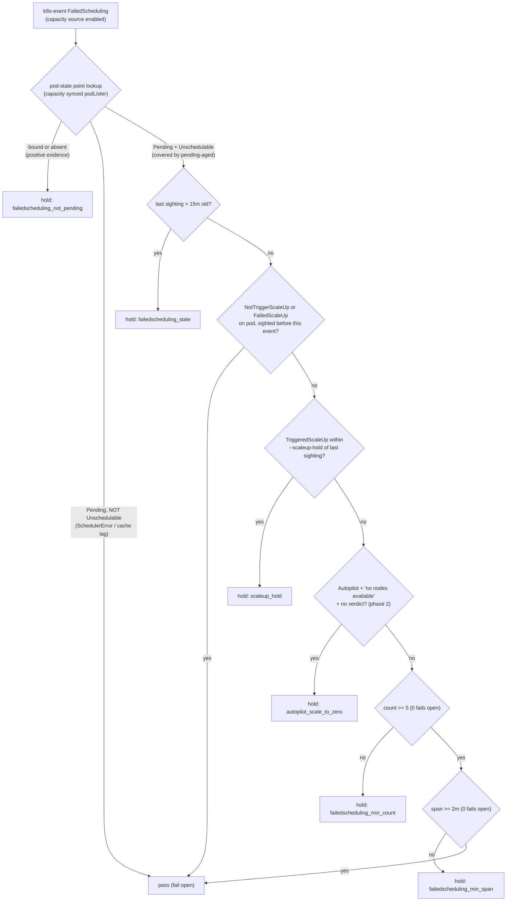

# `kube-agents` event-watcher noise controls — assessment and adoption plan

**Date:** 2026-11-18 · **Subjects:** `kube-agents` @ `ac3e39992` (2026-11-17) · `k8s-lookout` @ `d810e85` (`v0.43.2-9-gd810e85` / `v0.44.0-dev`)

**TL;DR:** Since the 2026-10-18 cross-assessment (`kube-agents/a2a/k8s-lookout-assessment.md`, an untracked working-tree file in `kube-agents`), `kube-agents`'s `k8s-event-watcher` and `session_kv_server.py` landed 14 PRs targeting false positives, duplicates, and chatter, including 30-day multi-cluster measurements for no-verdict `FailedScheduling`. `lookout watch` already outperforms the watcher on post-open lifecycle (exponential repeat backoff, state-based recovery, 4-tier storm correlation, same-class owner folding, SQLite store, and `leeway.LatestScaleUp` for `compute-class`), but has four real leading-edge gaps: no `events.k8s.io/v1` `Series` fallback (live on GKE Standard 1.37; reopens #218), ungated `FailedScheduling` during scale-ups, no duration-based settle gate for startup blips (#214's cheap alternative to a grace queue), and no per-object alert-exclude rules that keep a cluster watched. Adopt K3 (`Series` + fail-open), K2 (settle gate on crash-loop + message-allowlisted `Failed` only), K1 (`FailedScheduling` verdict + count/span gate guarded by a fail-open pod-state point lookup on `capacity`'s synced `podLister`, disabled when `capacity` is off; phase 2 Autopilot scale-to-zero via `pkg/cloud.Provider`), and K4 (`--alert-excludes <file>` routing matches to `info`, persisted when `--store` is set). Defer K5 cross-reason fold (conflicts with DESIGN §7.7); take no action on K5 fix-PR hold, K6 quiet follow-up, and K8; track K7 `Retry-After` as an unscheduled line in the umbrella issue.

Every `file:line` claim below was verified against `k8s-lookout @ d810e85` (`client-go v0.37.2`, `go.mod:36`) and `kube-agents @ ac3e39992` on 2026-11-18; grep commands are quoted where the answer is "nothing". Each section ends with an explicit **RECOMMENDATION** line.

**Contents**

1. [Context and method](#1-context-and-method)
2. [What lookout already has that the watcher does not](#2-what-lookout-already-has-that-the-watcher-does-not)
3. [Gate-by-gate matrix (K1–K8)](#3-gate-by-gate-matrix-k1k8)
4. [The adopted items, in lookout's shape](#4-the-adopted-items-in-lookouts-shape)
5. [Corrections to the 2026-10-18 assessment](#5-corrections-to-the-2026-10-18-assessment)
6. [Operator, agent, demo-scenario, and e2e impact](#6-operator-agent-demo-scenario-and-e2e-impact)
7. [Decisions table and consolidated action list](#7-decisions-table-and-consolidated-action-list)

---

## 1. Context and method

`kube-agents/k8s-operator/cmd/k8s-event-watcher` is the descendant of the watcher that seeded `lookout watch` ([`DESIGN.md` §7](../DESIGN.md#7-watch-path-lookout-watch-the-sentinel)). Both repositories shared the early count debounces (#197 crash-loop debounce, #213/#216 transient image-pull classifier), then diverged. `k8s-lookout` invested in leading-indicator sources, storm correlation, recovery tracking, repeat backoff (#599), `leeway` placement/verdict folding (#532), and replay tombstones (#816); `kube-agents` invested in pre-forward noise gates on the `core/v1.Event` stream and daemon-side folding in `agents/platform/scripts/session_kv_server.py`.

### 1.1 What changed in `kube-agents` since 2026-10-18

Before 2026-10-18, `k8s-event-watcher` had already added the initial `FailedScheduling` autoscaler-verdict gate (#1789, 2026-10-02) and the Autopilot scale-to-zero hold (#2606, 2026-10-08). Between 2026-10-18 and `ac3e39992` (2026-11-17), the watcher and `session_kv_server.py` landed 14 noise and resilience PRs:

| Date | PR | Change |
|---|---|---|
| 2026-10-23 | #3717 | Daemon-side workload fold (`INCIDENT_WORKLOAD_DEDUP_SECONDS`, cross-reason per workload) |
| 2026-10-23 | #3617 | Settle period (`--settle=2m`, `settleMemo`, `settle_outcomes_total`) and quiet follow-up (`--quiet-after=15m`) |
| 2026-10-30 | #4135 | Hold a workload's recurrence while a fix PR is open for review |
| 2026-10-30 | #4301 | `--failedscheduling-min-span=2m` for no-verdict `FailedScheduling`, plus `events.k8s.io/v1` `Series` read-through |
| 2026-11-02 | #4502 | Process-wide session-create cooldown breaker on 3 consecutive `429`/`5xx` answers to `POST /sessions` |
| 2026-11-02 | #4496 | Initial-list concurrency gate (`--initial-list-concurrency=4`) and protobuf wire preference |
| 2026-11-04 | #4528 | Log `FailedScheduling` gate decisions once per pod per 15 m rather than per sighting |
| 2026-11-04 | #4675 | Paged Event list (`limit=500`) fallback when `WatchList` is off, with pre-delivery autoscaler mark pass |
| 2026-11-04 | #4773 | `--alert-exclude` JSON rule list (stop matching events from opening incidents while keeping cluster in scope) |
| 2026-11-05 | #4855 | Add `Failed` `"Error: host IP unknown; known addresses:"` (node deletion race) to the settle family |
| 2026-11-06 | #4802 | Extend daemon workload fold to Job, StatefulSet, and DaemonSet pods via `controller_ref` |
| 2026-11-06 | #4913 | Log each alert-exclude rule at startup and export `alert_exclude_rules` / `alert_exclude_refused` gauges |
| 2026-11-10 | #5228 | `--alert-exclude-file` hot-reload without pod restart (re-read every `--profiles-rescan`, 1 m) |
| 2026-11-11 | #5466 | Add `Failed` `"Error: open …/etc-hosts: no such file or directory"` (pod deleted mid-start) to the settle family |

### 1.2 Verification method

1. **Primary source inspection:** read `kube-agents/k8s-operator/cmd/k8s-event-watcher/{README.md,filter.go,scaleup.go,settle.go,dedup.go,watcher.go,alertexclude.go,injector.go}` and `kube-agents/agents/platform/scripts/session_kv_server.py` at `ac3e39992`, plus the untracked working-tree `kube-agents/a2a/k8s-lookout-assessment.md` (dated 2026-10-18), against `k8s-lookout` at `d810e85` (`pkg/engine/`, `pkg/leeway/`, `pkg/sources/{k8sevents,capacity,computeclass}/`, `pkg/inject/`, `pkg/exempt/`, `pkg/cloud/`, `internal/watch/`, `examples/scenarios/`, `.github/workflows/e2e-kind.yml`) and `k8s.io/client-go@v0.37.2` (`tools/events/event_broadcaster.go`, `tools/record/events_cache.go`).
2. **Design-of-record review:** checked `docs/DESIGN.md` §7, `docs/leeway-design.md` §7.7.4 (`lines 2858–2890`, #532), `docs/cli-stability-policy.md`, and issues #197, #213, #214, #216, #218, #234, #545, #583, #599, and #816.
3. **Live read-only cluster verification (2026-11-18):** queried `core/v1` Events on `autoscale-arcade` (GKE Standard `1.37.1-gke.2097000`, 26,554 Events) to test `events.k8s.io/v1` `Series` population across emitters (results in §4.1).

**RECOMMENDATION.** Evaluate every `kube-agents` gate against `lookout`'s existing post-open controls, existing `leeway` verdict fold, `client-go` recorder mechanics, and frozen contracts before adopting it; port only the leading-edge mechanisms that address verified blind spots or false-positive classes in `lookout watch`.

---

## 2. What lookout already has that the watcher does not

These capabilities already exist in `k8s-lookout @ d810e85` and are strictly stronger than the `kube-agents` counterparts they overlap. None of them should be weakened or duplicated by porting `kube-agents` mechanisms verbatim:

- **Open-incident exponential repeat backoff (§7.4, #599):** `pkg/engine/repeat.go:24-80`, `pkg/engine/dedup.go:637-643`, `internal/watch/dispatch.go:208-211, 496`. When `--dedup-window` (default `5m`) lapses on a still-open incident, lookout sends `k8s-event-followup` with `repeat_count` on a doubling schedule (`5m → 10m → 20m → 40m → 1h` cap) instead of re-opening a session; material class changes emit at the first occurrence past `max(2 windows, current interval)` and take a backoff step (`repeat.go:40-50`), while 4× rate jumps (≥10 occurrences) bypass backoff immediately and reset the schedule (`repeat.go:50-51`). Supersedes `kube-agents`'s `24h` sliding dedup window.
- **State-based closed-loop recovery (§7.4):** `pkg/engine/recovery.go:29-59`, `internal/watch/flags.go:382`. `RecoveryTracker` polls live cluster state via `ClearanceObserver` and emits `kind=resolved` (`recovered` vs `object_deleted`) or `kind=resolved.reverted`. Strictly stronger than `kube-agents`'s silence-only `--quiet-after` follow-up (K6).
- **4-tier blast-radius storm correlation (§7.5):** `pkg/engine/storm.go:24-80`, `internal/watch/flags.go:392-402`. Groups cascading failures across External (registry host), Topology (`pkg/graph` node/owner/ConfigMap/PVC/namespace/zone), opt-in Mined, and Simultaneity tiers into one `kind=storm` session. `kube-agents` has no cross-workload storm correlator.
- **Same-class owner folding (`family.member`, §7.7, #583):** `pkg/sources/k8sevents/k8sevents.go:182-202, 345`, `internal/watch/reattach.go:182-203` (invoked from `internal/watch/dispatch.go:380`), `internal/watch/dispatch.go:742-743, 847-888`. Folds pods sharing an owning controller (Deployment across ReplicaSets, StatefulSet, DaemonSet, Job, CronJob) and the same kind + canonical reason into one session, even with `--storm=off`, resolved from real informer `ownerReferences` without guessing from pod names.
- **Per-pod autoscaler verdict fold in `leeway` / `compute-class` (#532):** `pkg/leeway/scaleup.go:19-124`, `pkg/sources/computeclass/state.go:457-516`, `docs/leeway-design.md:2858-2890`. Already folds `TriggeredScaleUp`, `NotTriggerScaleUp`, and `FailedScaleUp` per Pending pod (with `FailedScaleUp` treated as declined and same-second trigger/decline ties resolved toward provisioning) on the shared Event informer stream. `pkg/engine/filter.go` does not yet consume it (§4.3 addresses alignment vs deliberate divergences).
- **Per-severity routing with `info` class (§7.7):** `pkg/engine/routing.go:22-106`, `internal/watch/dispatch.go:222-232, 309-323`. Routes `critical` → per-incident session with warm enrichment (§7.6), `warning` → batched watchboard digest, `info` → `RouteStore` (persisted when `--store` is set, counted and logged otherwise). Eliminates `kube-agents`'s `filtered`/`suppressed` daemon status negotiation and policy-reopen machinery.
- **Agent-owned `severity_override` + regression evidence (§9.4):** `internal/watch/triage.go:36-80, 111-160`, `internal/watch/dispatch.go:268-271, 287-291`. Lets an agent mute a diagnosed incident by `(fingerprint, resource_key)` (cleared automatically on recovery, with `kind=triage.regressed` on count jumps). Covers the "diagnosed and waiting on a fix" use case without a Git-forge lookup in the sentinel.
- **Armed initial-list gate + unchanged `ResourceVersion` drop + replay tombstones (#816):** `pkg/sources/k8sevents/k8sevents.go:246-266, 300-333`, `pkg/engine/dedup.go:319-333, 624-627, 674-684, 1307-1335`. Drops pre-startup Event history on the floor, drops unchanged-RV relist/resync Updates at the source, and retains memory-bounded replay tombstones for `max(1h, 4×window)` after a resolved incident retires.
- **SQLite occurrence store + 15 leading-indicator sources + warm enrichment:** `internal/watch/flags.go:247, 420-436`, `pkg/sources/*`. Replaces per-cluster JSON snapshots and reactive-only watching.

**RECOMMENDATION.** Preserve all nine mechanisms unchanged. Reject any `kube-agents` port that replaces state-based recovery, per-severity routing, repeat backoff, or §7.7 same-class folding with weaker watcher-side workarounds, and align K1's verdict fold explicitly with `pkg/leeway/scaleup.go`.

---

## 3. Gate-by-gate matrix (K1–K8)

Verification greps run against `k8s-lookout @ d810e85` where lookout currently has nothing:

- `grep -rn "Series" pkg/sources/k8sevents/` → **0 hits** (contrast: `pkg/sources/computeclass/state.go:512-514` already reads `ev.Series.LastObservedTime`).
- `grep -rn "Retry-After\|RetryAfter" pkg/inject/` → **0 hits**.
- `grep -rn "KindAutopilotIdle\|Autopilot" pkg/sources/capacity/ pkg/sources/k8sevents/ pkg/engine/` → **0 code hits** (only a fixture comment at `pkg/engine/pullfailure_test.go:44`; `KindAutopilotIdle` lives exclusively in read-path `pkg/checks/delta/autopilot.go:49`).
- `grep -rn "alert.exclude\|AlertExclude\|alert_excluded\|gateSettle\|GateSettle\|scaleup_hold\|failedscheduling_min" pkg/ internal/watch/` → **0 hits**.

| # | Mechanism (`kube-agents @ ac3e39992`) | `lookout` today (`d810e85`, `file:line`) | Verdict | Issue |
|---|---|---|---|---|
| **K1** | **`FailedScheduling` gate** (`filter.go:635-776`, `scaleup.go:23-268`): stale >15 m hold; `NotTriggerScaleUp` passes if sighting > verdict (1 s precision); `TriggeredScaleUp` holds `--scaleup-hold=15m` against sighting; count backstop 5 (per Event object); min span `--failedscheduling-min-span=2m`; namespace-keyed bounded memo; per-pod decision log every 15 m. | **Ungated.** `pkg/engine/filter.go:196-235` has only 3 count gates (`Unhealthy`, `CrashLoopBackOff`, retryable `ImagePullBackOff`). `pkg/sources/k8sevents/k8sevents.go:349` stamps every `k8s-event` `SeverityCritical` → session on event #1. `pkg/sources/capacity/events.go:37-56` turns `TriggeredScaleUp` into `capacity.scaleup` (`SeverityInfo`) and `NotTriggerScaleUp` into `capacity.pending` (`SeverityWarning`), joined in `pkg/engine/dedup.go:458-459` — nothing holds `FailedScheduling`. (`pkg/leeway/scaleup.go:19-124` folds verdicts for `compute-class` only.) | **ADOPT** (phase 1 of I3; gated on `capacity` being enabled + fail-open pod-state point lookup on `podLister`) | `#TBD` (I3) |
| **K1 (phase 2)** | **Autopilot scale-to-zero hold** (`filter.go:379-384, 760-764, 890-894`): holds `FailedScheduling` when cluster is Autopilot + message is exact `"no nodes available to schedule pods"` + no CA verdict on record; auto-disables if CA reasons are absent. | **Nothing in watch path** (grep above: 0 code hits). `pkg/cloud/capabilities.go:682` already exposes `ClusterConfig.Autopilot` (`pkg/cloud/gke/clusterconfig.go:134`). | **ADOPT** (phase 2 of I3, via `pkg/cloud.Provider`; absent provider → fail open) | `#TBD` (I3) |
| **K2** | **Settle period + outcome counter** (`filter.go:626-628, 923-955`, `settle.go:22-235`): `--settle=2m` after count gates; `LastSeen.Sub(FirstSeen) >= settle`; family = crash-loop, `FailedMount`, `Unhealthy`, allowlisted `Failed` (`host IP unknown`, `open …/etc-hosts: no such file or directory`), 2 KCC reasons; tombstone for repeat blips; `settle_outcomes_total{forwarded\|self_resolved}`. | **Nothing** (grep above: 0 hits). `internal/watch/metrics.go:191-194` counts `lookout_events_filtered_total{gate}` for 6 gates, with no outcome counter. Issue #214's closing comment (2026-08-12) rejected a grace queue and named `LastSeen.Sub(FirstSeen) >= N` in the filter as the cheap form. | **ADOPT** (`CrashLoopBackOff` + allowlisted `Failed` ONLY; `FailedMount`/`Unhealthy` deferred; outcome counter folded into I2/I3; ship `(experimental)`) | `#TBD` (I2) |
| **K3** | **`events.k8s.io/v1` `Series` read-through + fail-open** (`watcher.go:1063-1092`, `filter.go:968-970`): fallback to `ev.Series.Count` / `ev.Series.LastObservedTime`; `eventTime` with `Series == nil` → count 1; `belowMinCount` fails open on `count <= 0`. | **Bug / latent blind spot.** `pkg/sources/k8sevents/k8sevents.go:357-395` reads only `ev.Count` (`:392`) and `ev.LastTimestamp` (`:365-371`) — grep for `Series` → 0 hits. `pkg/engine/filter.go:221, 225, 229` uses `sig.Count < min`, holding `Count == 0` forever. #218 closed as not reproducible on 1.36 Autopilot; **now observed on 1.37 Standard (§4.1)**. | **ADOPT (hard prerequisite for K1)** — reopens #218 | `#TBD` (I1) |
| **K4** | **Alert-exclude rules** (`alertexclude.go:64-287`, `filter.go:593-595`): JSON list `{cluster?, namespace?, reason?, kind?, name (trailing *)}`; drops matching events as `gate="alert_excluded"`; hot-reload every 1 m via `--alert-exclude-file`; malformed fails open with gauge; CA verdicts exempt. | **Nothing** (grep above: 0 hits). Today operators only have `--exclude-namespace` (`internal/watch/flags.go:236`, stops watching the namespace) or `--severity kind=level` (`flags.go:410`, whole kind). Read-path precedent: `pkg/exempt/exempt.go:19-41` ("exempt must not mean absent"). | **ADAPT → `info` downgrade** (`--alert-excludes <file>` YAML; persisted when `--store` is set, counted and logged otherwise; startup exit 2 on malformed; hot-reload) | `#TBD` (I4) |
| **K5 (fold)** | **Daemon-side cross-reason workload fold** (`session_kv_server.py:994-995, 2628-2706, 7769-7833`): 1 h from anchor (not sliding), folds any later event for `(cluster, ns, kind, fold_key)` *across reasons*; SQL `(? != ? OR severity = ?)` (`:2688`) folds non-Critical into an anchor of any severity, while Critical folds only into a Critical anchor. | `DESIGN.md` §7.7 deliberately scopes owner folding (`internal/watch/reattach.go:182-203`) to **same kind + canonical reason**, keeping a different failure class on the same workload separate; storm correlation (§7.5) handles multi-workload cascades. | **DEFER, no issue** (do not overturn DESIGN §7.7 without a measured cascade case) | — |
| **K5 (fix-PR hold)** | **Fix-PR recurrence hold** (`session_kv_server.py:7772-7818`): queries Git forge for open fix PRs and answers `folded`. | `internal/watch/triage.go:36-62` (§9.4 `severity_override`) already lets the agent mute a diagnosed incident until recovery, with zero Git-forge coupling in the sentinel. | **NO ACTION** (optional skill note at most) | — |
| **K6** | **Quiet follow-up** (`dedup.go:278-342`, `README.md` §3): one `k8s-event-followup` after `--quiet-after=15m` unsighted ("silence, not recovery"). | `pkg/engine/recovery.go:29-59` emits `kind=resolved` (`recovered`/`object_deleted`) from live cluster state. | **NO ACTION** (strictly superseded by §7.4 recovery) | — |
| **K7** | **Session-create cooldown breaker** (`injector.go:33-195, 243`): 3 consecutive `429`/`5xx` on `POST /sessions` → hold creates 60 s (or `Retry-After`, ≤300 s); rolls back dedup entry. | `pkg/inject/injector.go:165-168` returns an error on any non-201; `grep` for `Retry-After` → 0 hits. Retries occur only at the incident's next occurrence (§7.4), paced by kubelet/scheduler cadence; storms collapse burst cases. | **LOW / no issue now** — track "honor `Retry-After`" as an unscheduled line in I0; revisit if `core-agent` emits 429s | unscheduled line in I0 |
| **K8** | **Daemon status negotiation (`filtered`/`suppressed`/`folded`), 24 h sliding window, per-cluster JSON snapshots, paged initial list / startup-burst gate** (`README.md` §3, `watcher.go:116-145`). | Routing is in-process (`pkg/engine/routing.go`); #599 repeat backoff supersedes the 24 h window; SQLite store (`--store`); shared informer factory with paging/trimming (`pkg/kube`). | **N/A** | — |

**RECOMMENDATION.** File four implementation issues (I1 for K3, I2 for K2, I3 for K1 phases 1–2, I4 for K4) under one tracking umbrella (I0), with I1 as a hard prerequisite for I3. Do not file issues for K5–K8.

---

## 4. The adopted items, in lookout's shape

### 4.1 K3 — `events.k8s.io/v1` `Series` fallback and count-gate fail-open (I1, prerequisite)

#### Live `Series` verification (2026-11-18)

Executed read-only against `autoscale-arcade` (GKE **Standard**, `1.37.1-gke.2097000`, project `kcna-2026-demos`), 26,554 Events:

```bash
kubectl get events -A -o json | jq -r '
  .items
  | group_by(.reportingComponent // .source.component // "unknown")
  | map({
      reporter: (.[0].reportingComponent // .[0].source.component // "unknown"),
      events: length,
      legacy_count: ([.[] | select(.count != null and .count > 0)] | length),
      eventTime_only: ([.[] | select(.count == null and .eventTime != null)] | length),
      with_series: ([.[] | select(.series != null)] | length)
    })
  | sort_by(-.events)[]
  | [.reporter, .events, .legacy_count, .eventTime_only, .with_series] | @tsv'
```

And the per-event `FailedScheduling` shape check from #218:

```bash
kubectl get events -A -o json \
  | jq -r '.items[] | select(.reason=="FailedScheduling") | {count, firstTimestamp, lastTimestamp, eventTime, series}'
```

| Reporter | Events | legacy `count` | `eventTime`-only (`count: null`) | with `series` |
|---|---|---|---|---|
| `kubelet` | 13,019 | **13,019** | 0 | 0 |
| `cluster-autoscaler` | 448 | **448** | 0 | 0 |
| `default-scheduler` | 1,120 | 0 | **1,120** | 0 |
| `gke.io/optimize-utilization-scheduler` | 10,156 | 0 | **10,156** | 1,406 |
| `taint-eviction-controller` | 80 | 80 | 0 | 0 |

All 5,691 `FailedScheduling` events had `count: null`, `eventTime` set, and `series` populated only after the second occurrence. Kubelet's `BackOff`/`Unhealthy`/`Failed` all carried legacy `count` (max 15 on `Unhealthy`).

#### `events.k8s.io/v1` write cadence (`client-go v0.37.2`)

Any design that gates or deduplicates series-only events must account for `k8s.io/client-go@v0.37.2/tools/events/event_broadcaster.go`:

- `finishTime = 6 * time.Minute`, `refreshTime = 30 * time.Minute` (`:48-51`), driven by `refreshExistingEventSeries` (`:127-141`) and `finishSeries` (`:145-161`, started at `:396-398`).
- `recordToSink` (`:170-200`): occurrence 1 creates the Event (`eventTime` set, `series == nil`); occurrence 2 writes `series{count: 2, lastObservedTime: T2}`; **occurrence 3 and later only increment the in-memory series and return without writing to the API server**.
- The next API writes are either the **30-minute refresh** (`refreshExistingEventSeries`, while repeats continue) or the **finish write** (`finishSeries`, fired 6–12 minutes after the series stops receiving repeats — i.e., **after** the pod has scheduled or been deleted). `kube-agents` documents the same cadence (`README.md:45, 50`, `filter.go:222-227`).

**What the cluster check and write cadence settle:**

1. **#218 is reproducible on GKE 1.37 Standard.** Two variables changed between #218's closure (`v1.36.2-gke.2064000` Autopilot, where `gke.io/optimize-utilization-scheduler` emitted legacy `count: 9`, `series: null`) and this check (`1.37.1-gke.2097000` Standard, where both `default-scheduler` and `gke.io/optimize-utilization-scheduler` are series-only): both Kubernetes version (1.36 → 1.37) and mode (Autopilot → Standard). **1.37 Autopilot has not been checked yet** (relevant to I3 phase 2). `kube-agents/README.md:45`'s parenthetical `"on the core/v1 recorder (GKE's own schedulers, Autopilot included)"` no longer holds on GKE 1.37 Standard.
2. **Today's three count gates are unaffected** (kubelet is 100 % legacy), so I1 is not an active outage on kubelet reasons.
3. **Today's `FailedScheduling` handling is broken on repeats:** the first sighting opens a critical session (ungated, `count=0` on the wire), and every later series update leaves `LastSeen == EventTime` (`pkg/sources/k8sevents/k8sevents.go:365-371`). `DedupCache.ObserveSignal` (`pkg/engine/dedup.go:690-695`) therefore classifies every repeat as Case 1 **replay** (`!obs.LastTS.After(entry.EventLastTS)`), so #599 reminders never see even occurrence #2 or the 30-minute refresh.
4. **Late `finishSeries` false open (new defect to guard in I1 and I3):** once I1 reads `Series.LastObservedTime`, a pod that failed ≥3 attempts with the same message and then scheduled receives a `finishSeries` Update 6–12 minutes later carrying its final `count` and an advanced `lastObservedTime`. After I1 alone, if `RecoveryTracker` has already resolved and retired the incident, that Update looks like "new activity" (`pkg/engine/dedup.go:681-688` clears the tombstone; `:767-775` opens Case 3) and **opens a second critical session for a pod that has been Running for minutes** (hidden today by the replay bug). I1 must carry a dispatcher regression test for a post-resolve finish write, and I3 closes it via the fail-open pod-state point lookup on `capacity`'s synced `podLister` (§4.3).
5. **I1 is a hard prerequisite for I3**, as #214's closer warned: a count backstop over `Count == 0` would hold every stuck pod forever. The fallback must treat `series == nil` with `eventTime` set as **count 1** so the first occurrence is held like a legacy emitter's.
6. **The kind e2e exercises this live** because kind runs upstream `kube-scheduler` (series-only), allowing I1 and I3 to be tested against real series events without a GKE cluster.

#### Lookout-native shape

1. **`toTriageEvent` (`pkg/sources/k8sevents/k8sevents.go:357-395`)** — add legacy-first `Series` fallback (note: distinct from `pkg/sources/computeclass/state.go:505-516`, whose `eventTime` takes the *latest* of all timestamps because CA updates can bump either field):
   ```go
   count := int(ev.Count)
   last := ev.LastTimestamp.Time
   if ev.Series != nil {
   	if count == 0 {
   		count = int(ev.Series.Count)
   	}
   	if last.IsZero() {
   		last = ev.Series.LastObservedTime.Time
   	}
   }
   if count == 0 && !ev.EventTime.IsZero() {
   	count = 1 // first occurrence of a series (Series is nil until occurrence #2)
   }
   ```
   `last` then falls back to `ev.EventTime.Time`, then `ev.CreationTimestamp.Time` (unchanged); `first` remains `FirstTimestamp` → `EventTime` → `CreationTimestamp`.
2. **Fail-open guard in `Filter.Decide` (`pkg/engine/filter.go:219-233`)** — every count gate changes from `sig.Count < min` to `sig.Count > 0 && sig.Count < min`. A zero count means "emitter does not populate count", never "fewer than min"; failing open risks one noisy alert rather than permanent silence on a crash loop or stuck pod.
3. **Tests:** table over legacy-only, series-only first occurrence (`eventTime` set, `series == nil` → `Count=1`, `LastSeen=EventTime`), series-only repeat (`series.count=N`, `series.lastObservedTime=T2`), and both populated (legacy wins); unit test that `Count == 0` fails open on all count gates; dispatcher test that a repeating series-only event advances `EventLastTS` (reaching #599 repeat / Case 3 lapse instead of Case 1 replay) **and** a regression test documenting the post-resolve `finishSeries` Update behavior.

---

### 4.2 K2 — Settle gate (`GateSettle = "settle"`, I2)

#### Design-of-record lineage (#214) and evidence honesty

Issue #214 (closed 2026-08-12) evaluated and rejected a deferred grace queue (inverted `RecoveryTracker`) and named the cheap alternative: `LastSeen.Sub(FirstSeen) >= N` inside `pkg/engine/filter.go` — wall-clock units, no queue, no timers, no restart state loss, and emitting-node clock skew cancels because both timestamps come off the same Event object. #214's closer listed two revival triggers for the **grace queue**, not the age gate:

1. *"Production evidence that the count thresholds mis-tune — a family where `Count` and wall-clock diverge enough that no threshold is right, **and where an age gate does not fix it either**."* — **Not met** for K2: we are adopting the age gate itself because it fixes the count-vs-duration mismatch without a queue.
2. *"A family we want to gate that has no usable count. `FailedScheduling` during a node scale-up is the concrete candidate."* — Literally true on a series-only scheduler (§4.1), and answered without a grace queue because `capacity.pending-aged` (`pkg/sources/capacity/pending.go:175-198`) is *already* a live-state sweep over Pod `PodScheduled=False` (`Reason=Unschedulable`) conditions, and a point lookup on `capacity`'s synced `podLister` (`capacity.go:314-317, 532`) answers "still pending?" without a queue. #214's grace queue therefore stays rejected.

**Field-evidence scope:** `kube-agents`'s 30-day six-cluster dataset (`182` no-verdict pods, median 4 s pending, max 65 s) covers **only no-verdict `FailedScheduling`** (`kube-agents/filter.go:227-230`). K2's settle period rests on **one documented case** — a `BackOff` during kubelet object-cache warm-up on a fresh Autopilot node that cleared in 110 s (`kube-agents/filter.go:193-199`) — with no published fleet suppression rate. That is why the outcome counter (`lookout_watch_gate_outcomes_total`) and shipping `--settle` at the `(experimental)` CLI tier (`docs/cli-stability-policy.md:34`) in its first release are load-bearing.

#### Lookout-native shape

- **Gate, flag, and stability tier:** new `GateSettle = "settle"` in `pkg/engine/filter.go`, wired to additive flag `--settle` (default `2m`; `0` disables; marked `(experimental)` in its first minor release per `docs/cli-stability-policy.md:34`, promoted to Stable once `lookout_watch_gate_outcomes_total` confirms net-positive suppression without fragmenting storms — see §7.2 item (c) for the default-on vs default-`0` confirmation). Because changing default behavior is a minor-version event under Rule 4 ("Defaults are behavior", `docs/cli-stability-policy.md:56-60`), the implementing PR carries a CHANGELOG `### Changed` bullet naming the old and new crash-loop opening behavior and the `--settle=0` knob.
- **Position in `Filter.Decide`:** runs **after** the count gates (`filter.go:219-233`): a failure must have repeated **and** lasted (`sig.LastSeen.Sub(sig.FirstSeen) >= settle`). Zero timestamps (`FirstSeen.IsZero() || LastSeen.IsZero()`) fail open.
- **Settle family (keyed on `CanonicalReasonForEvent(sig.Key.Reason, sig.Message)`):**
  - `CrashLoopBackOff` — covers kubelet's repeating `BackOff` (`Back-off restarting failed container …`) and `CrashLoopBackOff`; excludes image-pull `BackOff` (which canonicalizes to `ImagePullBackOff`).
  - `Failed` — **explicit message allowlist ONLY**, never "every `Failed`":
    1. prefix `"Error: host IP unknown; known addresses:"` (kube-agents #4855: DaemonSet pod on a deleting node);
    2. prefix `"Error: open "` + suffix `"/etc-hosts: no such file or directory"` (kube-agents #5466: pod deleted mid-start, e.g. Autopilot balloon pods).
    *(Note: `Failed` is not in `defaultReasons` at `pkg/engine/filter.go:21-33`; this allowlist applies when `--reason` includes `Failed`.)*
- **Explicitly OUT of the default settle family — `FailedMount` and `Unhealthy`:**
  - `kube-agents` never ran either in production: its deployed entrypoint `--reason` list omits both, and `kube-agents`'s own README §2 rules 4 & 8 note both are "inert in a deployed install". There is zero field evidence for settling them.
  - In `k8s-lookout`, both are active in `defaultReasons` (`pkg/engine/filter.go:26, 29`). Kubelet re-emits `FailedMount` roughly every 2 minutes, so a 2 m span pushes the first inject to ≥4 minutes — breaking the `failed-mount` smoke-tier budget (`examples/scenarios/failed-mount/verify:25`) and causing `config-storm` members (`examples/scenarios/config-storm/verify:25-75`) to trickle past `--storm-window=60s`.
  - **Why `CrashLoopBackOff` stays in despite the storm-window trade-off:** multi-pod crash loops inside one Deployment are collapsed by §7.7 same-class owner folding (`foldSibling`, `internal/watch/reattach.go:182-203`), which has **no 60 s storm window**. A cross-Deployment crash-loop storm (unrelated Deployments failing simultaneously on a shared DB or ConfigMap) *can* see crossing times spread by kubelet's sync phase and its event spam bucket (see §6.1), risking storm fragmentation past `--storm-window=60s`. Shipping `--settle` as `(experimental)` with `lookout_watch_gate_outcomes_total` lets maintainers evaluate that trade-off on real traffic (§7.2 item (c)).
  - `FailedMount` and `Unhealthy` stay out by default and are listed in I2 as "extend only with field evidence".
- **Exempt reasons (never settled):**
  - Verdict / one-shot reasons (`OOMKilled`, `Evicted`, `NodeNotReady`) — emitted once per transition, so span is always 0 and settling would silence them.
  - `NetworkNotReady` — excluded because there is no field evidence of transient self-clearing noise that justifies delaying pod-sandbox networking failures.
  - Image-pull family (`ImagePullBackOff`, `ErrImagePull`) — retryable pulls already have `--imagepull-transient-min-count`; terminal bad tags must fire immediately.
  - `FailedScheduling` — handled by K1's verdict-first gate, which uses `--failedscheduling-min-span` only when no autoscaler verdict exists.
  - Non-allowlisted `Failed` — container start errors respect `restartPolicy` and under `Never` fire once.
- **Repeat-blip start and outcome counter (`dispatch.go:191-196` pipeline constraints):**
  - Because `d.filter.Decide(sig)` runs **before** `d.dedup.ObserveSignal(...)` (`internal/watch/dispatch.go:191-196`), a settle-held key never enters `DedupCache`. Meanwhile `DedupCache.tombstones` (`pkg/engine/dedup.go:319-333, 681-683, 1287, 1315-1335`) are created only when resolved entries retire, deleted on the first new activity, and memory-only.
  - The outcome counter (`lookout_watch_gate_outcomes_total{gate,outcome=forwarded|self_resolved}`) already requires a bounded per-cluster hold tracker in the dispatcher (4,096 entries; sweeps keys unsighted for `settle + 5m` — kubelet's 300 s back-off ceiling — as `self_resolved` and records a cleared tombstone with `EventLastTS`).
  - Before calling `d.filter.Decide(sig)`, the dispatcher computes the effective blip start: if the hold tracker holds a cleared tombstone (or a read-only `DedupCache.LastRetiredTS(key)` lookup returns a resolved incident's `EventLastTS` without deleting the replay tombstone) and `sig.LastSeen` is strictly after it, the dispatcher records that first post-tombstone `sig.LastSeen` as the blip's start and passes an adjusted `FirstSeen` copy into `Decide`.
  - **Restart semantics:** both the hold tracker and #816 tombstones are **memory-only** (`dedup.go:325-327`), so a sentinel restart fails open on repeat-blip start (falls back to the Event object's own `FirstTimestamp`, matching `kube-agents/README.md:56`).

---

### 4.3 K1 — `FailedScheduling` verdict gate (I3, two checklist phases)

#### Alignment with existing `pkg/leeway/scaleup.go` (#532)

`k8s-lookout` already has a per-pod autoscaler verdict fold in `pkg/leeway/scaleup.go:19-124` + `pkg/sources/computeclass/state.go:457-516` (`docs/leeway-design.md:2858-2890`, #532). I3 must not invent a silently divergent second copy. Every alignment and deliberate divergence is stated here (and surfaced in §7.2):

| Design point | Existing `leeway` / `computeclass` | I3 (`FailedScheduling` gate) | Resolution |
|---|---|---|---|
| **`FailedScaleUp`** | Treated as declined (`scaleup.go:29-31, 55, 105-106`) | Adopt (`capacity/events.go` adds `FailedScaleUp` to verdict recording) | **Align.** A `TriggeredScaleUp` followed by `FailedScaleUp` (stockout, quota, provision timeout) must release the 15 m hold immediately rather than waiting out `--scaleup-hold`. |
| **Reporter check** | Matched on reason alone (`state.go:460-462`: *"the component name is not something GKE documents"*) | `kube-agents` requires `cluster-autoscaler` (`scaleup.go:37-47`) | **Verify before enforcing (§7.2 item (f)).** Our 1.37 Standard check confirmed `cluster-autoscaler` on 448 events (§4.1), but Autopilot/NAP was not measured. I3 verifies NAP's reporter string on Autopilot before enabling a hard reporter check (or matches reason alone / allowlists observed CA/NAP reporters, relying on the 15 m `capacity.pending-aged` bound below). |
| **Same-second tie** | Trigger wins (`scaleup.go:93-96, 119-120`) | Two distinct comparisons: (a) trigger vs decline verdict tie → reuse `leeway.LatestScaleUp` (trigger wins, bounded by `--scaleup-hold`); (b) decline vs `FailedScheduling` sighting → truncate both to 1 s and require `sighting > verdict` (`kube-agents/filter.go:659-670, 736`) | **Align (a), keep (b).** (b) prevents a same-second pre-verdict sighting from passing after a restart/replay on microsecond `events.k8s.io/v1` timestamps. |
| **Key and bound** | `(namespace, name)` + UID/creation check; bounded by Event `DeleteFunc` (`state.go:74-78, 483-495`) | `(namespace, uid)`, capped at 4,096 per cluster, namespace-fair eviction (`kube-agents/scaleup.go:151-170`), TTL `max(--dedup-window, --scaleup-hold + 15m)` | **Justified divergence.** Keying on `(namespace, uid)` with per-namespace fair eviction bounds memory even if Event deletes lag (1 h TTL) and stops a tenant in one namespace from spoofing a UID or evicting another namespace's verdicts. |

#### Decision flow (active ONLY when `capacity` source is enabled)



#### Lookout-native architecture

1. **All-or-nothing gate when `capacity` is off (hard safety rule):** `pkg/sources/capacity` owns the CA verdict memo, `capacity.pending-aged`, and the synced `podLister`. Because `--sources=auto` can skip `capacity` when its grants are absent (`internal/watch/flags.go:247`) and `--sources=k8s-events` omits it, **if the `capacity` source is not enabled, the entire `FailedScheduling` gate is disabled** (restoring today's event-#1 behavior) with one loud startup log line. Never hold `FailedScheduling` for up to 30 m on a series-only scheduler without `capacity.pending-aged` running as the safety net.
2. **Fail-open pod-state point lookup (`capacity`'s synced `podLister`) — closing `finishSeries` without silencing `SchedulerError`:**
   - Do **not** gate on membership in `capacity.Unschedulables()` (`pkg/sources/capacity/pending.go:86-100`). That helper copies the entire pending map per call (`:89-99`) and tracks **only** pods with `PodScheduled=False` and `Reason=Unschedulable` (`pending.go:127-136, 163-171`). The scheduler also emits `FailedScheduling` for `Reason=SchedulerError` (plugin, extender, or volume-binding errors — `k8s.io/api/core/v1` `PodReasonSchedulerError`); those pods are in neither `Unschedulables()` nor `capacity.pending-aged`, so a closed membership check would hold them forever with no safety net. Two informers can also race because the scheduler records the Event before patching the Pod condition.
   - Instead, expose a narrow **point lookup** on `capacity` reading its synced `podLister` (`pkg/sources/capacity/capacity.go:314-317, 532`, O(1) cache lookup by `(namespace, name)` plus UID check) and run it **first** in the gate:
     - **Bound (`spec.nodeName != ""` / `phase != Pending`) or absent from the synced cache** (or UID mismatch because the pod was recreated) → **positive evidence** the pod is no longer pending: hold as `failedscheduling_not_pending`. This cleanly blocks a 6–12 m delayed `finishSeries` write (§4.1) for an already-Running or deleted pod, and subsumes the restart-replay reason `kube-agents` needed `failedscheduling_stale` (`README.md:45`, since `k8s-events` already drops its initial Event LIST at `pkg/sources/k8sevents/k8sevents.go:246-250, 264-266, 305-316`).
     - **Pending + `PodScheduled=False` with `Reason=Unschedulable`** → covered by `capacity.pending-aged`: proceed to stale / verdict / Autopilot / count / span.
     - **Pending, NOT tracked as `Unschedulable`** (`SchedulerError`, or brief informer-sync lag before the condition patch lands) → **pass immediately (fail open, as today)**, because nothing else will page for it. Same rule as #1 above, enforced per pod: *hold only what the `capacity.pending-aged` safety net covers*.
3. **Verdict view (`ScaleUpVerdicts()` on `pkg/sources/capacity`):** sibling of `Unschedulables()` (`pending.go:86-100`, adapted via a narrow interface in `internal/watch/wiring.go:1494-1518`), exposed behind a small `engine.ScaleUpVerdictLookup` interface (alongside the pod-state point lookup) so `pkg/engine` never imports `pkg/sources/capacity` or `pkg/cloud`.
   - **Pre-arm recording:** `capacity/events.go:60-72` currently returns immediately while `!s.armed`. Verdict recording must run **before** the `!armed` check (matching `trackPod` in `pending.go:124-127`) so CA marks present on the initial LIST are already recorded when `k8s-events` arms.
   - **Timestamp discipline:** store the event's latest timestamp (`LastTimestamp` → `Series.LastObservedTime` → `EventTime` → `CreationTimestamp`), clamped to `now` if zero or ahead of the local clock (`kube-agents/scaleup.go:228-243`). Measure `--scaleup-hold` against `sig.LastSeen.Sub(verdict.At)` rather than wall clock so replays age identically to live sightings.
4. **Forged-event residual and its 15 m bound:** as `kube-agents/README.md:44` notes, `source.component` / `reportingController` is author-written, not authenticated. A principal with `create events` in a namespace can forge `TriggeredScaleUp` repeatedly and keep a pod's `k8s-event` `FailedScheduling` held. In `k8s-lookout`, the mute is **bounded at 15 minutes** by `capacity.pending-aged` (`pkg/sources/capacity/capacity.go:154`, `pending.go:163-171`), which reads Pod `status.conditions` rather than Events — and that bound holds specifically because rule 1 above disables the gate whenever `capacity` is off and rule 2 gates only `Reason=Unschedulable` pods.
5. **Per-pod decision logging:** log each pod's `FailedScheduling` gate decision once when new, changed, or >15 m since last logged (bounded memo, preventing logging-agent OOM on large Pending fleets — `kube-agents` #4528, `filter.go:258-299, 800-832`). Every sighting still increments `lookout_events_filtered_total{gate}`.
6. **Additive flags & CLI stability (`internal/watch/flags.go`, `docs/cli-stability-policy.md`):**
   - `--failedscheduling-min-count` (default `5`; `1` disables count backstop)
   - `--failedscheduling-min-span` (default `2m`; `0` disables span backstop)
   - `--scaleup-hold` (default `15m`; `0` disables `TriggeredScaleUp` hold)
   - `--autopilot-scale-to-zero-hold` (phase 2, default `true`)
   Shipped `(experimental)` in their first minor release (`cli-stability-policy.md:34`), with a Rule 4 CHANGELOG `### Changed` bullet (`cli-stability-policy.md:56-60`). Setting `--failedscheduling-min-count=1 --failedscheduling-min-span=0 --scaleup-hold=0 --autopilot-scale-to-zero-hold=false` disables the entire `FailedScheduling` gate (including the stale and `not_pending` holds when all four knobs are off, so today's exact event-#1 behavior remains reachable by flag per Rule 4).
7. **Safety net (`capacity.pending-aged`):** `pkg/sources/capacity/pending.go:175-198` (`warning` at `--pending-age` 5 m, `critical` at `CriticalPendingAge` 15 m, `capacity/capacity.go:154`) is unchanged. On a **series-only** scheduler (§4.1), `capacity.pending-aged` critical (15 m) becomes the primary pager for `Reason=Unschedulable` pods (both declined post-occurrence-2 and no-verdict); `Reason=SchedulerError` pods pass immediately via rule 2.
8. **Phase 2 (checklist inside I3) — Autopilot scale-to-zero hold:**
   - Reads `ClusterConfig.Autopilot` via `pkg/cloud.Provider` (`pkg/cloud/capabilities.go:682`, `pkg/cloud/gke/clusterconfig.go:134`) during sentinel startup (no cloud SDK imports in `pkg/engine` or `pkg/sources`).
   - **Provider boundary (AGENTS.md hard rule):** when no cloud provider is linked (default GCP-free build) or `ClusterConfig` is unavailable, `autopilot` is false → hold does not fire (fail open), with one startup log line.
   - Matches exact trimmed message `"no nodes available to schedule pods"` + `Autopilot == true` + `verdict == unheard`. Not keyed on scheduler reporter (`kube-agents/filter.go:877-884`). Automatically off whenever `capacity` is disabled (rule 1 above).

---

### 4.4 K4 — Alert-exclude rules → `info` downgrade (I4)

#### Why `info`, not drop — and explicit amendments against `pkg/exempt` (#234)

`kube-agents` drops alert-excluded events (`gate="alert_excluded"`) and adds a separate 30-second side-channel POST (`/v1/excluded-events`) so the daily recap does not lose sight of them (`kube-agents/README.md` §2 rule 3). `k8s-lookout` already has the `info` severity class (`RouteStore`, `pkg/engine/routing.go:38-44, 71-72`), which persists signals in `--store` when configured (and counts/logs them when `--store` is unset, `internal/watch/dispatch.go:314-321`) while never opening a session or watchboard entry. Downgrading to `info` instead of dropping borrows `pkg/exempt`'s principle **"exempt must not mean absent"** (`pkg/exempt/exempt.go:19-32`).

Plan Q2 selected a new `--alert-excludes <file>` flag with minimal YAML schema mirroring `--exemptions` (`--policy` is an `audit` read-path flag at `pkg/checks/audit/policy.go:37`, not a watch precedent). Comparing Q2's schema directly against `pkg/exempt/exempt.go` (#234) surfaces five explicit divergences that require maintainer confirmation (§7.2 item (a)):

| `pkg/exempt` decision (`pkg/exempt/exempt.go`) | I4 (`--alert-excludes <file>`) | Reason for divergence (proposed amendment) |
|---|---|---|
| Rejects ConfigMaps (`:38-40`: *"can be edited without review"*) | Supports hot-reload of a mounted file (ConfigMap in GitOps deployments) | `exempt` runs per CLI invocation; `lookout watch` is a long-running Deployment where restarting on a rule edit drops in-memory state/tombstones. Operators should manage the ConfigMap via GitOps PR review; direct `kubectl edit` is an acknowledged operational trade-off. |
| Requires `reason` (justification) and `expires` (`:42-49, 110-114`) | Minimal schema has no required justification or expiry (`reason` = event reason) | Audit exemptions waive security/posture defects that rot silently; watch alert-excludes demote known-noisy operational workloads (canary/loadgen namespaces) to `info` rather than hiding posture gaps. Optional `comment`/`expires` fields remain additive-compatible; unlike DESIGN §9.4 `severity_override` (`DESIGN.md:903-912`), these are operator-owned, not agent-owned. |
| Exact `name` only, no globbing (`:100-105`) | Trailing `*` prefix on `name` (e.g. `loadgen-*`) | Audit findings target Deployments/Services (stable names); `k8s-event` subjects are usually Pods with generated suffixes. **Lookout-native alternative for I4:** also consider an exact `owner` matcher against resolved `ControllerRef` (#583, `internal/watch/triage.go:51-55`), which matches a Deployment's pods with zero globbing. |
| Top-level key `exemptions:` (`:141-146`: distinguishes truncated file from empty) | Bare YAML list per Q2 (`[{namespace, reason, kind, name}]`) | Minimal Q2 schema; wrapping under a top-level `excludes:` key in I4 is a low-cost safeguard against truncated hot-reloads (§7.2 item (a)). |
| `kind` required (`:91-94`: prevents global off-switch) | At least one field required; bare `name: "*"` rejected | Operators need namespace-scoped silence (`{namespace: staging-canary}`) that keeps the namespace watched and recorded as `info` without listing every reason. |

#### Lookout-native shape & routing edge cases

- **Flag:** `--alert-excludes <file>` (additive flag in `internal/watch/flags.go`, `(experimental)` in its first minor release per `docs/cli-stability-policy.md:34`).
- **YAML schema:**
  ```yaml
  # Each rule matches when every non-empty field matches (AND).
  # At least one field must be set; bare name: "*" is rejected.
  - namespace: staging-canary
    reason: CrashLoopBackOff   # matches wire or canonical reason, case-insensitive
    kind: Pod                  # case-insensitive
    name: loadgen-*            # exact match, or trailing "*" prefix only
  ```
  - No label selector (an Event carries its own labels, not the involved object's; `pkg/exempt/exempt.go:85-89`, `kube-agents/alertexclude.go:61-63`).
  - Autoscaler verdict reasons (`TriggeredScaleUp`, `NotTriggerScaleUp`, `FailedScaleUp`) are **refused at load time** so a rule cannot blind K1's verdict memo.
  - Multi-cluster mode: optional `cluster` matcher (`cluster` name, optional `project` and `location`).
- **Routing and precedence rules (closing all five edge cases):**
  1. **`--mode=shared`:** severity routing is ignored in shared mode by frozen contract (`pkg/engine/routing.go:22-25`, `internal/watch/dispatch.go:310`), so an `info` downgrade would still inject. Passing `--alert-excludes` with `--mode=shared` must fail at startup as a **usage error (exit 2)** so operators never assume exclusions are active when shared mode ignores them (§7.2 item (g)).
  2. **`--store` defaults to empty (`internal/watch/flags.go:433`):** `routeInfoSignal` (`internal/watch/dispatch.go:314-321`) persists `info` rows only when `--store` is set; otherwise it counts and logs (`info-drop`). Document explicitly in `--alert-excludes` help text that persistence requires `--store`.
  3. **Precedence vs §9.4 `triage.Apply` (`internal/watch/dispatch.go:265-271`, `internal/watch/triage.go:118-133`):** evaluate `--alert-excludes` **after** `d.routing.Classify` AND **after** `d.triage.Apply` (§7.2 item (h)). Otherwise an open `status=escalated` or severity-upgrade triage record would override the operator's exclude file and re-page an excluded workload.
  4. **Hot-reload onto an already-open incident (`pkg/engine/dedup.go:750-775`):** when a newly loaded rule downgrades an already-open incident's opener kind to `info`, `ObserveSignal` sees `Repeatable == false` and `obs.Kind == entry.SourceKind`: sightings inside the active window stay Case 4 (deduped), and at window lapse Case 3 replaces the entry with an unbound `info` entry routed to `RouteStore` — stopping further reminders while the existing session finishes or receives `kind=resolved` from `RecoveryTracker`.
  5. **Dedicated metric (do not overload `lookout_events_filtered_total`):** `lookout_events_filtered_total{gate}` documents *"rejected by the engine filter before dedup"* (`internal/watch/metrics.go:191-194`). An alert-excluded signal is **not** rejected before dedup — it enters `routeInfoSignal` (and increments `infoDropped`, `dispatch.go:313`). Export a dedicated counter `lookout_watch_alert_excluded_total` (plus gauges `lookout_watch_alert_exclude_rules` and `lookout_watch_alert_exclude_refused`) so `lookout_events_filtered_total` keeps its exact pre-dedup rejection semantics.
- **Validation, audit logging, and hot reload:**
  - **Startup:** a missing, unreadable, or malformed `--alert-excludes` file is a **fatal usage error (exit 2)** — a deliberate divergence from `kube-agents`'s fail-open startup (`alertexclude.go:123-139`), aligned with DESIGN §11 explicit errors.
  - **Audit trail on load/reload (`kube-agents` #4913, `alertexclude.go:143-152`):** log each rule in force on its own line at startup and on every successful reload, alongside the `lookout_watch_alert_exclude_rules` gauge. With no mandatory expiry or justification on a rule, the startup/reload log lines and gauge are the audit trail.
  - **Hot reload (`kube-agents` #5228):** re-read the file periodically (e.g., 1 m ticker) or on `SIGHUP`. On a malformed or unreadable *reload*, keep the previously loaded valid rules in force, log loudly, and set `lookout_watch_alert_exclude_refused` to `1` (resetting to `0` on the next valid reload).

**RECOMMENDATION.** Build I1 → I3 in order (I1 unblocks I3), and schedule I2 and I4 independently. Require `capacity` enabled for K1, use a fail-open pod-state point lookup on `capacity`'s synced `podLister` (never fail-closed `Unschedulables()`), align K1's `FailedScaleUp` handling with `pkg/leeway/scaleup.go`, ship K1/K2/K4 flags `(experimental)` with Rule 4 CHANGELOG notes, and keep I4's startup validation strict (exit 2) with per-rule audit logging and a dedicated `lookout_watch_alert_excluded_total` counter.

---

## 5. Corrections to the 2026-10-18 assessment

`kube-agents/a2a/k8s-lookout-assessment.md` (dated 2026-10-18; an untracked working-tree file, not committed at `ac3e39992` — `git ls-files a2a/k8s-lookout-assessment.md` is empty) Part 2 (`lines 123–140`) contains three inaccuracies against `k8s-lookout @ d810e85`:

1. **`FailedScheduling` & Cluster Autoscaler Marks (`line 135`) — rated "Covered & Architecturally Cleaner".** Incorrect on both counts it cites:
   - *No scale-up hold exists on `k8s-event`.* `pkg/sources/capacity/events.go:37-56` maps `TriggeredScaleUp` to `capacity.scaleup` (`SeverityInfo`) and `NotTriggerScaleUp` to `capacity.pending` (`SeverityWarning`), and `pkg/engine/dedup.go:458-459` shares the `FailedScheduling` dedup family — but nothing holds a `k8s-event` `FailedScheduling` on a live `TriggeredScaleUp`. Because `pkg/engine/filter.go:196-235` has no `FailedScheduling` gate and `pkg/sources/k8sevents/k8sevents.go:349` stamps `SeverityCritical`, every ordinary scale-up opens a critical session on event #1 and then resolves minutes later.
   - *`KindAutopilotIdle` is read-path only, not watch-path.* `KindAutopilotIdle = "cluster.autopilot_idle"` (`pkg/checks/delta/autopilot.go:49`) is consumed only by `pkg/checks/{delta,health,scan}`. Zero watch-path packages reference it (`grep -rn "KindAutopilotIdle" pkg/sources/ pkg/engine/ internal/watch/` → 0 hits).
2. **"Every single event reason and debounce rule from `kube-agents` is preserved in `k8s-lookout`" (`line 127`) — now stale.** Since 2026-10-18, `kube-agents` added K1's minimum span (#4301), K2's settle period and allowlisted `Failed` config errors (#3617, #4855, #5466), K3's `Series` read-through (#4301), K4's alert-excludes and hot reload (#4773, #4913, #5228), K5's workload fold and fix-PR hold (#3717, #4802, #4135), K6's quiet follow-up (#3617), and K7's session-create breaker (#4502). None of those are in `k8s-lookout @ d810e85`.
3. **Default `k8s-events` allow-list expansion (`line 131`) — overstated.** `pkg/sources/k8sevents/k8sevents.go:71-86` defines `DefaultEventReasons` (including `Failed`, `Killing`, `FailedAttachVolume`, `FailedCreatePodSandBox`, `OOMKilling`, `Rebooted`, `FailedScaleUp`), but `internal/watch/wiring.go:1526` does not pass it to `WithReasons` and `pkg/engine/filter.go:21-33` (`defaultReasons`, 11 reasons) is the active gate (`filter.go:201-205`). Those extra wire reasons are rejected at `GateReasonNotAllowed` unless an operator widens `--reason`.

**RECOMMENDATION.** Treat this document — not Part 2 of the untracked `kube-agents/a2a/k8s-lookout-assessment.md` — as the baseline for watch-path noise-control parity between the two repositories.

---

## 6. Operator, agent, demo-scenario, and e2e impact

### 6.1 What changes for external operators and agent consumers

All new flags are additive with defaults **on** (except `--alert-excludes`, opt-in by path) and governed by `docs/cli-stability-policy.md` Rule 4 ("Defaults are behavior", `:56-60`: minor-version event, CHANGELOG `### Changed` bullet naming old and new behavior, old behavior reachable by flag) and Rule 2 (`(experimental)` marker on initial release, `:34`). The frozen `k8s-event` wire payload fields and signal-schema v1 ledger do not change. Nothing changes for deployed users until a release ships the implementing PRs.

Because `events.k8s.io/v1` recorders batch occurrence 3+ in memory until the 30 m refresh (`client-go v0.37.2 tools/events/event_broadcaster.go:48-51, 170-200`, §4.1), the `FailedScheduling` rows distinguish legacy-count vs series-only schedulers explicitly:

| Surface | Before | After (defaults) — legacy-count recorder | After (defaults) — series-only recorder (`events.k8s.io/v1`) | Knob to restore |
|---|---|---|---|---|
| **Crash loop → first session** (I2) | at `Count ≥ 3`, ~30–70 s after first `BackOff` | **bimodal 2–5 min:** ~125–160 s if a `BackOff` write lands inside `client-go`'s default 25-event per-object spam burst (`tools/record/events_cache.go:47-48, 510-518`; kubelet's recorder options were not verified from kubelet source — I2 measures this on kind) past the 2 m mark, or ~300 s+ if the spam filter throttles writes to 1 per 300 s before t+120 s | n/a (kubelet is legacy-count) | `--settle=0` |
| **Startup blip that clears < 2 m** (I2) | session opened, then `kind=resolved` ~5 m later — two injects, one wasted agent turn | nothing on the wire; counted as `self_resolved` after `settle + 5m` unsighted | n/a | `--settle=0` |
| **`FailedScheduling` during an ordinary scale-up** (I3, `capacity` on) | critical session on event #1, resolved minutes later | held while `TriggeredScaleUp` is < 15 m old; nothing opens if the pod lands | same, plus late 6–12 m `finishSeries` write held as `failedscheduling_not_pending` via `podLister` point lookup | `--scaleup-hold=0` (or disable all K1 knobs) |
| **Stuck pod, `Reason=Unschedulable`, autoscaler declined (`NotTriggerScaleUp` / `FailedScaleUp`)** (I3, `capacity` on) | critical session on event #1 | opens on scheduler's next retry after the verdict (≤ 5 m) | opens at occurrence #2 if the verdict landed before it, otherwise up to **30 m** (next series refresh) — **`capacity.pending-aged` critical (15 m) becomes the primary pager** (for `Reason=Unschedulable` pods) | disable all 4 K1 knobs (below) |
| **Stuck pod, `Reason=Unschedulable`, no autoscaler verdict** (I3, `capacity` on) | critical session on event #1 | `Count ≥ 5` **and** span ≥ 2 m (up to ~20 m on a quiet cluster); `capacity.pending-aged` (warn 5 m, crit 15 m) fires first | `Count ≥ 5` visible only on the **30 m** series refresh; **`capacity.pending-aged` critical (15 m) is the primary pager** (for `Reason=Unschedulable` pods) | `--failedscheduling-min-count=1 --failedscheduling-min-span=0 --scaleup-hold=0 --autopilot-scale-to-zero-hold=false` |
| **Stuck pod, `Reason=SchedulerError` (or pod-cache lag)** (I3, `capacity` on) | critical session on event #1 | **unchanged (event #1, fail open)** — not tracked by `capacity.pending-aged`, so the pod-state point lookup passes it | **unchanged (event #1, fail open)** | automatic |
| **`FailedScheduling` with `capacity` source OFF** (I3) | critical session on event #1 | **unchanged (event #1)** — whole K1 gate auto-disabled with loud startup log | **unchanged (event #1)** — whole K1 gate auto-disabled | automatic |
| **Series-only emitters** (I1) | `Count=0`; repeats read as replays | legacy unchanged | `count` and `last_seen` populated from `series`; occurrence #2 + 30 m refreshes feed #599 reminders | — |
| **Alert excludes** (I4) | only `--exclude-namespace` (drops from watch) or `--severity kind=level` (whole kind) | `--alert-excludes <file>` (per-incident mode; exit 2 with `--mode=shared`): matching events route to `info` — persisted when `--store` is set, counted & logged otherwise (`dispatch.go:314-321`), never paged; cluster stays watched | same | omit the flag |
| **Metrics** | `lookout_events_filtered_total{gate}` with 6 gates (`internal/watch/metrics.go:191-194`) | new filter gates `settle`, `failedscheduling_stale\|not_pending\|min_count\|min_span`, `scaleup_hold`, `autopilot_scale_to_zero`; new `lookout_watch_gate_outcomes_total{gate,outcome=forwarded\|self_resolved}`; dedicated `lookout_watch_alert_excluded_total` + `alert_exclude_{rules,refused}` gauges | same | — |
| **Docs / skills / deploy** | — | each implementing PR regenerates `skills/` references + `docs/site` reference pages (`dev/tools/gen-skill-refs`, `dev/tools/gen-site-docs`), updates `deploy/51-deployment-watcher.yaml` comments and `deploy/chart` values, and adds a Rule 4 CHANGELOG `### Changed` entry | same | — |

**Agent consumer impact (`core-agent` / AX sink):** fewer noise sessions; a crash-loop opening payload arrives ~90–240 s later with `count ≥ 5`; on series-only schedulers a `Reason=Unschedulable` `FailedScheduling` incident opens primarily from `capacity.pending-aged` (15 m critical) or after a `NotTriggerScaleUp`/`FailedScaleUp` — `skills/k8s-capacity/SKILL.md:99-103` already teaches agents to expect `capacity.pending` and `capacity.pending-aged` alongside `FailedScheduling`, and I3 should add one line noting that "the autoscaler already declined" is a likely state on arrival.

### 6.2 Demo scenarios (#545 / `core-agent#1223`) and `examples/scenarios`

| Scenario | Touched by | Effect | Action |
|---|---|---|---|
| S4 zonal skew (`leeway`), S1 frozen ingress (`gateway`), S5 storm | none of I1–I4 | — | none |
| `crashloop` (**smoke tier**, `.github/workflows/e2e-kind.yml:21, 111`) | I2 | With `--settle=2m`, if kubelet uses `client-go`'s default 25-event per-object spam filter (`tools/record/events_cache.go:47-48, 510-518`; not verified from kubelet source), first inject is bimodal (~125–160 s, or **~300 s+** if the 25-event burst exhausts before t+120 s on `examples/scenarios/crashloop/inject:21-23`), risking timeouts against `await_inject crashloop 300` (`crashloop/verify:20`) | **Measure on kind in I2**, and pass a drill-speed `--settle=90s` in `examples/sentinel/up:112-120` alongside `--pending-age=75s` and `--rollout-observe=90s` (gives `crashloop` first inject at ~95–110 s inside the 25-event burst, and leaves headroom for `crash-blip` below) |
| `failed-mount` (**smoke tier**, `e2e-kind.yml:21, 111`), `config-storm` (`examples/scenarios/config-storm/verify:25-75`) | would be I2 **if** `FailedMount` were in the settle family | kubelet re-emits `FailedMount` every ~2 m, so a 2 m span means ≥ 4 m to first inject, and storm members would trickle past `--storm-window=60s` | **`FailedMount` and `Unhealthy` excluded from K2's default settle family (§4.2)** |
| `pending` (`examples/scenarios/pending/verify:21`) | I1, I3 | today `k8s-event` opens first (`count=0` on series-only kind) and `pending-aged` attaches; after I3 on kind (no CA) the `k8s-event` is held and `capacity.pending-aged` opens first. `verify` matches `capacity.pending`, so it keeps passing — but stops exercising the `k8s-event` path | I1 asserts `k8s-event` `count ≥ 1` on `pending`; when I3 lands, `pending` asserts `k8s-event` is held and `pending-scaleup` takes over the live `Series` `count ≥ 1` assertion (§6.3) |
| `probe-flap` | none (`Unhealthy` excluded from settle) | — | none |
| `image-pull`, `oom`, `bad-rollout`, `cert-expiry`, `pdb-gridlock`, `endpoints-empty`, `cron-missed` | none (image-pull and verdict reasons are exempt by design) | — | none |

### 6.3 e2e / drill additions

Hermetic unit + `internal/watch` drill tests remain the sole PR gate (AGENTS.md: no live-cluster test gates a PR). The kind e2e additions below run post-merge in `.github/workflows/e2e-kind.yml` and are tracked as checklist items on each issue:

| Issue | Addition | What it proves |
|---|---|---|
| **I1** | `examples/scenarios/pending/verify`: also `await_inject pending 360 'kind=k8s-event' 'FailedScheduling' 'hog-'` and assert payload `count ≥ 1` (kind's upstream `kube-scheduler` is series-only, making this the live `Series` test) | fallback populates `count` / `last_seen` on a real series-only emitter |
| **I2** | With drill-speed `--settle=90s` in `examples/sentinel/up:112-120`: new **negative** weekly scenario `crash-blip` (container exits non-zero **4 times** using an `emptyDir` marker — accumulating kubelet back-offs `10s + 20s + 40s` plus ~5–10 s run time ≈ 75–80 s, crossing `--backoff-min-count=3` so it enters `GateSettle` and stabilizing inside `< 90s`): assert **no** `k8s-event` `BackOff` inject **and** `lookout_watch_gate_outcomes_total{gate="settle",outcome="self_resolved"} ≥ 1` on `/metrics` (wait sized for `90s + 5m` sweep slack ≈ 7–8 min, or shorter if a drill-speed slack knob is added); `crashloop` stays in smoke tier with first inject at ~95–110 s | settle gate suppresses a post-count-gate blip and makes suppression observable, with one consistent drill-speed `--settle=90s` for both scenarios |
| **I3** | (1) `pending/verify` on kind: replace I1's `k8s-event` open check (which cannot pass once I3 holds no-verdict `FailedScheduling`) with an assertion that `k8s-event` does **not** open before `capacity.pending-aged` and `lookout_events_filtered_total{gate="failedscheduling_min_count"} ≥ 1`; (2) new weekly scenario `pending-scaleup` using two sequential `hog` pods to avoid the series-only post-occurrence-2 write race (§4.1): pod A gets a forged `TriggeredScaleUp` (`source.component: cluster-autoscaler`) → wait up to 360 s across occurrence #2 (~5 min on kind) and assert **no** `k8s-event` open **and** `lookout_events_filtered_total{gate="scaleup_hold"} ≥ 1` (proving the hold rather than `min_count`); pod B gets a forged `NotTriggerScaleUp` **before** occurrence #2 (plus, if reporter filtering is enabled, a wrong-reporter `source.component: fake-controller` `TriggeredScaleUp` negative) → assert `k8s-event` opens with `count ≥ 1` (inheriting I1's live `Series` check) | hold (`scaleup_hold` counter proved, not `min_count`), decline-passes path, live `Series` `count ≥ 1`, and reporter check (when enabled) without a real autoscaler; phase 2 Autopilot hold and exact post-occurrence-2 cadence stay hermetic unit/drill tested |
| **I4** | UAT-style fixture: `examples/sentinel/up` gains an optional `ALERT_EXCLUDES` ConfigMap **and** enables `--store` (currently unset in `examples/sentinel/up:96-133`) when active; a `crashloop` run under `{namespace: lookout-demo, reason: CrashLoopBackOff}` asserts no session, `lookout_watch_alert_excluded_total ≥ 1`, and an `info` row in `--store` | excluded ≠ absent when `--store` is enabled |
| **I0** | smoke tier stays `crashloop + failed-mount + bad-rollout`; `crash-blip` (~7–8 min) and `pending-scaleup` (~8–10 min) join the weekly set | preserves CI budget discipline (`examples/README.md`) |

**RECOMMENDATION.** Ship each implementing PR with its hermetic unit + `internal/watch` drill tests, generated reference docs, deploy/Helm flag updates, Rule 4 CHANGELOG entry, and the corresponding post-merge kind e2e checklist item.

---

## 7. Decisions table and consolidated action list

### 7.1 Settled decisions (from the approved plan, 2026-11-18)

| # | Question / Plan change | Decision |
|---|---|---|
| Q1 | I3 granularity | **One issue, two checklist phases:** phase 1 = autoscaler-verdict gate + count/span backstop; phase 2 = Autopilot scale-to-zero hold via `pkg/cloud.Provider` (absent provider → fail open). |
| Q2 | Alert-exclude rule source | **New `--alert-excludes <file>`**, minimal YAML schema `[{namespace, reason, kind, name (trailing * = prefix)}]`; startup exit 2 on malformed; hot-reload without restart (kube-agents #5228). Loader reuse left to the implementing PR. |
| Q3 | Labels and parenting | I1: `bug`, `detection-gap`. I2/I3/I4: `enhancement`. New umbrella I0 (`tracking`); one-line cross-reference comment on #545 pointing at I0 (#545 does not own this work). |
| Q4 | GKE Standard `Series` check | **Verified 2026-11-18** on `autoscale-arcade` (1.37 Standard): both schedulers are series-only; kubelet and cluster-autoscaler are legacy; 1.37 Autopilot remains unverified. Reopens #218; I1 is a hard prerequisite for I3. |
| A1 | Settle family scope | **`FailedMount` and `Unhealthy` excluded from K2 by default** (`kube-agents` never ran them; they break our smoke tier and `config-storm` 60 s window). Default family = `CrashLoopBackOff` + allowlisted `Failed` messages only. |
| A2 | K7 sink breaker | **Not filed as a standalone issue**; tracked as an unscheduled checklist line ("honor `Retry-After` in `pkg/inject`") in I0. |

### 7.2 Amendments raised in review — need maintainer confirmation

These refinements surfaced during adversarial review against the existing codebase (`pkg/leeway/scaleup.go`, `pkg/exempt/exempt.go`, `client-go v0.37.2`, `docs/cli-stability-policy.md`) and go beyond the original plan; confirm before the implementing PRs lock them in:

| ID | Amendment | Recommendation |
|---|---|---|
| **(a)** | **Five `pkg/exempt` divergences in I4 (§4.4):** ConfigMap hot-reload, no mandatory justification/expiry, trailing `*` vs exact `ControllerRef` owner match, bare list vs top-level `excludes:` wrapper, any single field vs required `kind`. | **Confirm** Q2's operational divergences; adopt a top-level `excludes:` wrapper in I4 to guard against truncated hot-reloads, and weigh adding an optional exact `owner` (`ControllerRef`) field alongside `name`. |
| **(b)** | **CLI stability tier at first release (`docs/cli-stability-policy.md:34`):** mark all new K1/K2/K4 flags `(experimental)` in their first minor release. | **Confirm.** Avoids locking new noise-gate flag names/defaults into Stable before observing production metrics. |
| **(c)** | **`--settle` initial default (`2m` vs `0`):** K2 rests on a single documented 110 s case (`kube-agents/filter.go:193-199`) and carries bimodal spam-filter latency + cross-Deployment storm-window trade-offs. | **Confirm default `2m` marked `(experimental)`** (per plan) so real deployments emit `lookout_watch_gate_outcomes_total` immediately (`--settle=0` restores prior behavior); switch to opt-in default `0` only if maintainers prefer zero default change until measured. |
| **(d)** | **K1 safety guards (§4.3):** auto-disable the entire `FailedScheduling` gate when `capacity` is off, and run a fail-open pod-state point lookup on `capacity`'s synced `podLister` (hold `not_pending` only on positive bound/absent evidence; fail open on `SchedulerError`/lag). | **Confirm.** Required so no pod is ever held for 30 m without `capacity.pending-aged` covering it, and late `finishSeries` writes cannot reopen resolved pods. |
| **(e)** | **Align `FailedScaleUp` as declined (`pkg/leeway/scaleup.go:29-31, 55`).** | **Confirm.** A failed scale-up (stockout/quota) should release the 15 m hold immediately. |
| **(f)** | **CA reporter check vs reason-alone (`pkg/sources/computeclass/state.go:460-462`).** | **Verify Autopilot/NAP reporter string in I3** before enforcing a hard `cluster-autoscaler` reporter filter; otherwise match reason alone (bounded at 15 m by `capacity.pending-aged`). |
| **(g)** | **Reject `--alert-excludes` with `--mode=shared` at startup (exit 2).** | **Confirm.** Shared mode ignores severity routing (`pkg/engine/routing.go:22-25`), so accepting the flag would silently ignore every rule. |
| **(h)** | **Evaluate `--alert-excludes` after `triage.Apply` (`internal/watch/dispatch.go:265-271`).** | **Confirm.** Operator-declared exclude file must outrank an agent-written `status=escalated` or severity-upgrade triage record. |

### 7.3 Consolidated action list

| Order | ID | Issue | Labels | Dependencies | Summary |
|---|---|---|---|---|---|
| 0 | **I0** | `#TBD` | `tracking` | tracks I1–I4 | Umbrella: links this assessment, I1→I4 checklist in dependency order, smoke vs weekly e2e tier discipline, unscheduled K7 `Retry-After` line, and deferred/no-action verdicts (cross-referenced from #545) |
| 1 | **I1** | `#TBD` | `bug`, `detection-gap` | none (blocks I3) | `sources/k8sevents`: read `Series.count`/`Series.lastObservedTime`, treat `eventTime` + `Series==nil` as count 1, fail count gates open on `Count==0` (reopens #218), dispatcher regression test for post-resolve `finishSeries` write + `pending/verify` `count ≥ 1` assertion |
| 2 | **I2** | `#TBD` | `enhancement` | none | `engine/filter`: `--settle=2m` `(experimental)` gate on `CrashLoopBackOff` + allowlisted `Failed` messages, hold tracker + blip-start clamping (reusing #816 retired timestamps read-only), `lookout_watch_gate_outcomes_total`, kind measurement + `--settle=90s` in `examples/sentinel/up` + `crash-blip` (4 exits) negative e2e |
| 3 | **I3** | `#TBD` | `enhancement` | **depends on I1** | `watch`: `FailedScheduling` gate (phase 1: `ScaleUpVerdicts()` on `capacity` aligned with `leeway.LatestScaleUp` + `FailedScaleUp`, fail-open pod-state point lookup on `capacity`'s synced `podLister`, auto-off when `capacity` is off, namespace-keyed memo, stale/declined/hold/count/span, per-pod log memo; phase 2: Autopilot scale-to-zero via `pkg/cloud.Provider`) + `pending` / `pending-scaleup` e2e |
| 4 | **I4** | `#TBD` | `enhancement` | none | `watch`: `--alert-excludes <file>` `(experimental)` YAML rules downgrading matching events to `info` (`RouteStore`, after `triage.Apply`), exit 2 at startup on malformed or `--mode=shared`, per-rule load/reload audit logging, hot-reload without restart, dedicated `lookout_watch_alert_excluded_total` counter + `ALERT_EXCLUDES` (`--store` enabled) e2e fixture |

**RECOMMENDATION.** Confirm the §7.2 review amendments on this PR, then execute I1 first so `FailedScheduling` repeats and series-only counts are accurate before I3 gates them; land I2 and I4 in parallel as independent PRs, each amending `docs/DESIGN.md` §7 and `CHANGELOG.md` (`### Changed`) alongside its code and tests.
