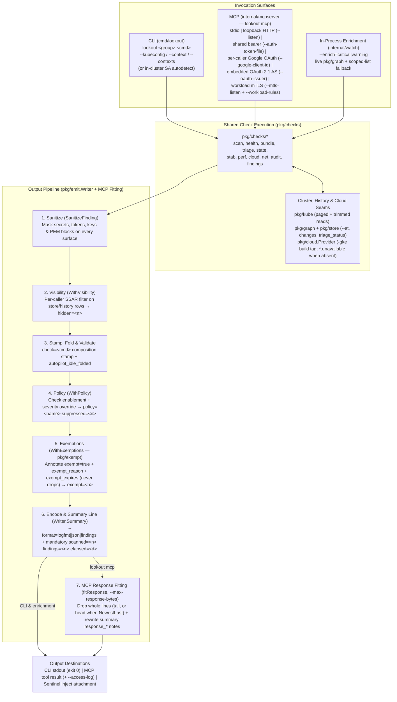
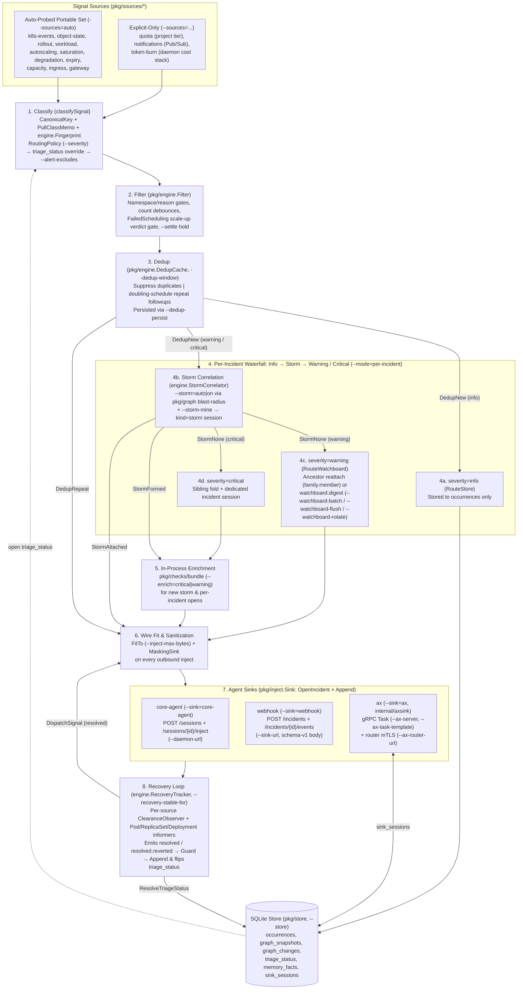

This page explains how `lookout` is put together: two ways in — one-shot
commands you run mid-investigation, and a resident watcher that lives in
the cluster — and why both share a single binary. If you have wondered
why the output is so terse, or why a healthy resource prints nothing,
the answer is one of a handful of principles everything else follows
from:

- **Token density.** Raw telemetry costs money, evicts context, and slows
  the loop. Deterministic pre-compression — dedup by template, strip nominal
  state — sits between every high-volume source and the context window.
- **Determinism.** A compiled graph traversal does not hallucinate an
  EndpointSlice. Checks are exact; the model reasons over their output, never
  re-derives it.
- **Fewer round trips.** One dense, correlated payload beats five sequential
  tool calls. This pushes toward fewer, wider tools (`lookout bundle`,
  `lookout health`) and pre-warmed incident sessions.
- **Leading indicators over autopsies.** A Kubernetes Event is the autopsy.
  State transitions, trend slopes, and countdowns run ahead of it — the
  watch-path exists to surface them first.
- **Zero nominal state, never ambiguous silence.** Healthy resources are
  omitted; every invocation ends with an explicit summary line
  (`scanned=412 findings=0 elapsed=1.2s`) so "cluster healthy" is
  distinguishable from "broken invocation".
- **Read-only in the cluster.** Tools inspect and diagnose. The only
  sanctioned write actions — GitOps PRs and quota-increase requests — route
  through the `core-agent` daemon's permission gate, never raw write
  authority.

## The read-path

One-shot diagnostic commands an agent (or a human) runs mid-investigation
or on a standing schedule:
`triage`, `state`, `stab`, `perf`, `cloud`, `net`, `audit`, `findings`,
plus the composed `scan`, `bundle`, and `health`. All of them share a
single check implementation in `pkg/checks` and one `pkg/emit.Writer`
pipeline, consumed by three invocation surfaces:

- **CLI** — for deployments where the agent or operator has a shell.
- **MCP** — [`lookout mcp`](/getting-started/mcp/) serves every registered
  command 1:1 as an MCP tool (selectable via `--profile` and `--tools`)
  over `stdio`, loopback HTTP, authenticated off-host HTTP (shared bearer
  token, per-caller Google OAuth, or `lookout`'s embedded OAuth 2.1
  authorization server), and workload mTLS (`--mtls-listen`).
- **In-process enrichment** — the sentinel calls the same `bundle` check
  directly to pre-warm incident sessions; no fork/exec, shared informer
  cache.

Whatever the surface, the output contract is identical: one finding per line
(logfmt by default, `--format=json` for JSON-per-line, or
`--format=findings` for a JSON array of findings), keys in fixed order,
healthy resources silent, a mandatory final summary line. Exit `0` is pure
payload on stdout; exit `1` puts diagnostics on stderr only, so a captured
stream never corrupts a context window; exit `2` is a usage error.

## The watch-path

`lookout watch` is a resident per-cluster **sentinel**: pluggable signal
sources feeding one pipeline (`internal/watch`), ending in injects to an
agent sink (`core-agent`, `webhook`, or `ax`) and closing the loop on
recovery.

*(In `--mode=shared`, watchboard and per-incident enrichment are disabled and every post-dedup signal appends directly to `--target-session`.)*

The sources (enabled per deployment via `--sources`) cover reactive and
leading classes: `k8s-events` (the reactive baseline), `object-state`
(transitions: node flaps, emptied endpoints, gridlocked PDBs), `rollout`
(stalls caught while the old revision still serves), `workload` (failed
Jobs and CronJob schedules that stop producing runs), `autoscaling` (HPA
thrash and ceiling pinning), `saturation` (slope → ETA forecasts),
`degradation` (ready-ratio trends), `expiry` (certificate countdowns),
`capacity` and `quota` (cluster-autoscaler and project-quota seams),
`ingress` and `gateway` (controller/GCLB and Gateway API path failures),
`notifications` (the provider's own upgrade events and security
bulletins), and `token-burn` (agent spend as a saturation dimension).
Placement-skew and GKE `ComputeClass` fallback sweeps live in standalone
[`go-steer/leeway`](https://github.com/go-steer/leeway).
The full flag surface is in
[Reference → `lookout watch`](/reference/watch/); every signal kind is
cataloged in [Reference → Signal kinds](/reference/signal-kinds/).

A sentinel with `--store` also keeps a bounded, TTL'd SQLite file: every
emitted signal with its routing outcome, plus topology snapshots and the
per-delta change log. That store is what powers point-in-time queries
(`--at`) and the triaged-reality merge described in
[The closed loop](/concepts/closed-loop/).

## Why one binary

Earlier designs specced a matrix of per-check binaries; each would have
statically linked client-go and cloud SDKs into a multi-gigabyte image with
dozens of drifting flag surfaces. Instead there is one multicall binary,
`lookout`, busybox-style: one release, one image, one client bootstrap, one
output-envelope implementation — and an agent discovers the entire surface
from one `--help`.

The same discipline applies to documentation: command metadata (name, flags,
when-to-use line, output-field glossary) is declared once and generates
`--help`, the MCP schemas, the skill reference docs in
[`skills/`](https://github.com/go-steer/k8s-lookout/tree/main/skills), and
the [Reference](/reference/) section of this site. Drift tests fail CI when
any generated surface goes stale.

## The contract with core-agent

Three boundaries, all pre-existing: the sentinel posts sessions and injects
to the daemon's HTTP API; the `token-burn` source reads the daemon's cost
stack; and fleet-level tooling consumes the
[frozen signal schema](/concepts/signals-and-fingerprints/). Fleet scope is
explicitly out of scope here — `lookout` deploys per cluster (or per project,
for the quota source), and cross-cluster rollup joins signals, not graphs.
