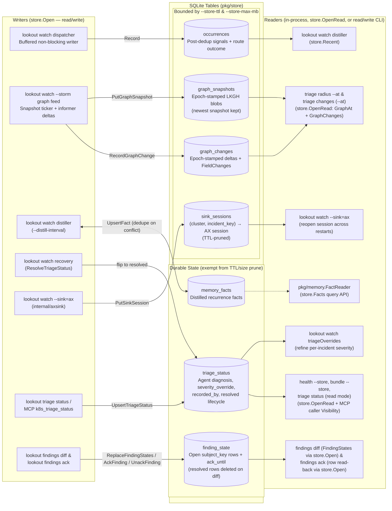

`--store=/var/lib/lookout/lookout.db` gives the sentinel a local,
embedded SQLite store (pure Go, no cgo) — put it on the same volume as
`--dedup-persist`. Startup confirms it, along with the history feed when
storm correlation provides the graph:

```
store: enabled (path=/data/lookout.db, ttl=720h …)
graph history: enabled (snapshot every 1m0s + per-delta change log …)
graph history: baseline snapshot stored (generation 3, 51 nodes, 62 edges) — --at queries answerable from here on
```

(Startup lines from a live validation drill.)

## Who writes and reads each table

A single `--store` SQLite file (`modernc.org/sqlite`, WAL mode) holds bounded telemetry tables alongside durable state tables (see `pkg/store`). The diagram below shows which mode writes and which mode reads every active table:



*(Schema migrations `v7` and `v8` — `leeway_alert_state` and `leeway_baseline` — are retired in-place after `#842` so existing stores upgrade cleanly through `schema_version`, and are neither written nor read by `lookout`.)*

## What's in it

- **Occurrences** — every post-dedup signal, including info-severity
  ones that never inject anywhere, each with its routing outcome
  (`injected | suppressed | storm | storm-member | watchboard |
  info-stored | resolved`) and session id. This is the audit ledger the
  drills read back, and the input to the scheduled distiller pass
  (`--distill-interval`) that turns recurring occurrences into durable
  facts.
- **Graph history** — compressed topology snapshots every
  `--graph-snapshot-interval` (default 5m) plus the per-delta change
  log. Written only when storm correlation runs (that is the graph
  feed). This is what serves `--at` point-in-time queries and `triage
  changes`' full delta log. A store also widens the feed: it watches
  the routing layer (Services, EndpointSlices, Ingresses,
  NetworkPolicies) so history answers `Selects`/`RoutesTo` like live
  does (#507). Each of those kinds is probed at startup; one the role
  cannot watch is skipped with a `graph history: not recording <Kind>`
  line rather than failing the sentinel, and named in `unrecorded=`.
  EndpointSlice updates that only flip readiness are filtered before
  they reach the log, so the routing layer costs rows per membership
  change, not per readiness flip.
- **Triage-status records** — the diagnosis records written by
  [`lookout triage status`](/reference/triage-status/) and flipped to
  `resolved` automatically by recovery injects.

## Bounds — telemetry, not a system of record

- `--store-ttl` (default `720h`, 30 days): the prune loop deletes older
  rows.
- `--store-max-mb` (default `512`): oldest occurrences are pruned first
  when exceeded — loudly (`store_pruned_rows_total{cause="size"}`).
- Writes are non-blocking: a full writer buffer or failed batch insert
  loses records rather than stalling the pipeline, counted in
  `store_write_drops_total` by cause. Alert on that counter — see
  [Observing `lookout`](/operations/observability/).

## Copying the store off a pod

The image is distroless — **`kubectl cp` does not work** (no tar in the
container). The store must sit on a volume you can reach another way:

- **hostPath + node access.** On GKE:
  `gcloud compute scp <node>:/var/lib/lookout/lookout.db* ./store/ --zone=<zone>`
  (or `gcloud compute ssh <node> -- sudo cat …`). On kind:
  `docker cp <node>:/var/lib/lookout/… .`
- **A PVC** you can mount from a debug pod.

Copy all of `lookout.db`, `lookout.db-wal`, and `lookout.db-shm` — the
WAL sidecar files carry recent writes. Copying while the sentinel is
live is fine: WAL mode absorbs the concurrent reader (a validation
drill copied and queried a live store while the sentinel kept writing).

## `--at`: answering questions about the past

Graph-backed commands (`triage radius`, `triage changes`) accept
`--at=<RFC3339|duration-ago> --store=<copy>` and answer from history —
no cluster access on the query path. From a live drill, 28m34s
after a bad-deploy onset, against the copied store:

```console
$ lookout triage radius webapp-55866d5cff-cwgp4 -n drill-a --at=2026-07-26T10:54:55Z --store=lookout.db
kind=radius.neighbor … kind_of_object=ReplicaSet name=webapp-55866d5cff direction=upstream relation=Owns hop=1
kind=radius.neighbor … name=webapp-77f8d7558c-7gvwx direction=lateral relation=shared-node hop=2 shared=Node/kl-m3-worker
…
scanned=69 findings=13 elapsed=6ms source=history at=2026-07-26T10:54:55Z

$ lookout triage radius webapp-55866d5cff-cwgp4 -n drill-a          # same question, LIVE
lookout triage radius: workload Pod/drill-a/webapp-55866d5cff-cwgp4 not found in the topology
```

The at-onset answer contains the broken-revision pod and ReplicaSet the
live cluster has already forgotten. The summary line always says which
world answered: `source=live`, `source=history at=<t>`, or
`source=live-approximation` (the honest degraded mode without a store).
`triage changes --at` reads the same delta log — its last entry before
onset named the bad rollout in the drill.

## Epochs: what happens across sentinel restarts

Every sentinel process writes snapshots and change rows under a fresh
**epoch** id, because a process's graph re-interns node ids — replay is
only meaningful within one process's rows. The semantics for `--at`:

- **Inside an epoch's coverage** → that epoch's state, snapshot +
  replayed deltas, exactly as observed.
- **In the gap between epochs** (sentinel down, or the new process's
  pre-baseline window) → the prior epoch's last known state. Nothing was
  observing the cluster in the gap, so the last observed state is
  everything the store honestly knows.
- **Before the first snapshot of the first epoch** → no history; the
  query says so rather than approximating.

Restarts are therefore routine: a store spanning upgrades and evictions
keeps answering, and each instant resolves within the process that
actually observed it.

## The store as a scan input

The store also upgrades read-path scans:
[`lookout health --store=…`](/reference/health/) and `bundle --store=…`
merge open triage-status records into findings — a scan run mid-incident
carries `triage_status=`, `triage_root_cause=`, the session pointer, and
the agent's severity override instead of re-reporting a fresh unknown —
captured end-to-end in a live drill.
